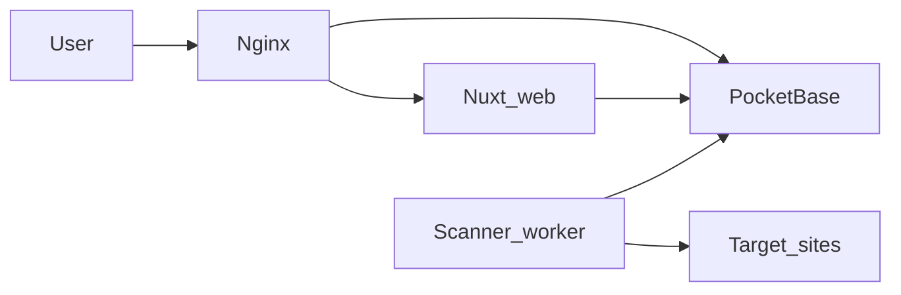

# SiteNook: Agent Onboarding

You are joining an existing repo. Help implement and fix features **without breaking stack conventions**. Work incrementally, prefer small safe changes, and verify with tests or linters when relevant.

## Project overview

**SiteNook** is a self-hosted web accessibility and QA monitoring platform (an open-source SiteImprove-style replacement under the MIT License). It crawls registered sites with **Playwright** and **axe-core**, stores results in **PocketBase**, and exposes a **Nuxt dashboard** for WCAG issues, broken links, spelling, policies, and scan management.

Billing (Stripe / Polar) is optional and off by default (`SITENOOK_COMMERCIAL=0`). See [docs/commercial.md](docs/commercial.md).

## Stack

| Layer | Technology |
|-------|------------|
| Frontend | Vue 3 + **Nuxt 4** (Nuxt UI, Tailwind) |
| Scanner | Node.js + **TypeScript (ESM)**, Playwright, axe-core |
| Backend / DB | **PocketBase** 0.25.x (schema via JS migrations) |
| Infra | Docker Compose + Nginx reverse proxy |
| Runtime | Node.js >= 18 |

## Repository layout

| Path | Purpose |
|------|---------|
| `apps/web/` | Nuxt 4 dashboard — `app/pages/`, `components/`, `composables/`, `middleware/`, `plugins/`, `utils/`, `types/`; Nitro routes in `server/api/` |
| `apps/scanner/` | TypeScript worker: polls `scan_queue`, runs crawls and QA checks |
| `services/pocketbase/` | PocketBase Docker image, bootstrap scripts, **`pb_migrations/`** schema |
| `nginx/` | Reverse proxy: `/` → web, `/api/` and `/_/` → PocketBase |
| `docker-compose.yml` | Production-style stack: nginx, web, scanner, pocketbase |
| `docker-compose.override.yml` | Dev overrides: hot reload, ports 3000 / 8090 |

## Architecture (data flow)



1. User manages sites and scans in the Nuxt dashboard.
2. Dashboard reads/writes PocketBase via the JS SDK.
3. Scanner polls `scan_queue`, crawls sites with Playwright, runs axe + QA checks, writes results to PocketBase.

## Core data model (PocketBase)

Hierarchy: **sites → scans → pages → findings** (accessibility issues, broken links, spelling, policy matches).

| Collection | Role |
|------------|------|
| `sites` | Registered targets; `schedule`, `schedule_next_run_at`, `default_scan_config` |
| `scans` | Scan runs (`status`: queued/running/complete/failed/**cancelled**) |
| `pages` | Per-page crawl results linked to a scan |
| `accessibility_issues` | axe findings; dismissable; linked to page + scan |
| `qa_broken_links`, `qa_spelling`, `qa_inventory` | QA findings per scan/page |
| `policies`, `policy_matches` | Custom content policy rules and hits |
| `scan_queue` | Worker queue (`pending` → `processing` → complete/failed/**cancelled**) |

Schema lives in `services/pocketbase/pb_migrations/` (latest: `1730000012_site_default_daily_schedule.js`). Runtime patches in `patch-*.sh` extend migrations (cancel status, schedule fields, rules).

## Key runtime pipelines

These are the highest-connectivity flows in the codebase (see `graphify-out/GRAPH_REPORT.md`):

1. **Scan execution** — `scan_queue` → `processQueueItem()` (`apps/scanner/src/index.ts`) → `crawlSite()` → axe + QA → `saveSinglePageResult()` → PocketBase batch writes (via `recordSanitize.ts`).
2. **Scheduled scans** — `scanScheduler.ts` ticks due sites → `enqueueScheduledScan()` → `scan_queue` → same pipeline as manual scans. Schedule math shared with web via `scheduleNextRun` utils (scanner + `apps/web/app/utils/scheduleNextRun.ts`).
3. **Web data layer** — `usePocketBase` → feature composables (`useSites`, `useScans`, `useAccessibility`, `useQA`, `useInventory`) → PocketBase SDK + `reloadScheduler` debounced realtime refresh.
4. **Auth** — `pocketbase.client.ts` plugin → `usePocketBase` → `auth.ts` / `guest.ts` middleware.
5. **Global search**. Scanner indexes crawl HTML/PDF text into **Typesense** (`apps/scanner/src/search/`); web `GET /api/global-search` queries Typesense (`TYPESENSE_ENABLED=1`). Backfill: `cd apps/scanner && npm run reindex-search`.

## Key conventions

### Web (`apps/web`)

- **PocketBase access**: use existing wiring. Do not invent a second client.
  - `app/composables/usePocketBase.ts`
  - `app/plugins/pocketbase.client.ts`
  - Feature composables: `useSites`, `useScans`, `useScanQueue`, `useAccessibility`, `useQA`, `useInventory`
  - Shared utils: `pbFilter`, `pbAuth`, `scanConfig`, `scheduleNextRun`, `reloadScheduler`, `scanDisplay`, `affectedPages`, `issueExplanation`
  - UI areas: `components/scans/` (site-centric scan table, runs, pages), `components/accessibility/`, `components/qa/`, `components/shared/`
  - Nitro API: `server/api/sitemap-preview.get.ts`
- **Auth**: PocketBase `users` collection (`authWithPassword`); guards `app/middleware/auth.ts` (protected) and `guest.ts` (login/signup); shared state via VueUse `createSharedComposable`.
- **Package manager**: `package.json` declares `pnpm`; Docker dev may use `npm`. Match scripts in the directory you are editing.

### Scanner (`apps/scanner`)

- ESM TypeScript under `apps/scanner/src/`.
- Entry: `src/index.ts`. Polls `scan_queue`, runs `processQueueItem()`, handles cancellation and stale-job recovery.
- Important modules: `config/scanConfig.ts`, `accessibility/` (axe, WCAG map, diff), `crawler/`, `qa/`, `db/recordSanitize.ts`, `scheduler/` (`scanScheduler.ts`, `scheduleNextRun.ts`), `search/` (Typesense indexer).

### Schema

- Collections and fields defined in `services/pocketbase/pb_migrations/`; do not edit `pb_data/` directly.
- Recent additions: scan **cancellation** status (`1730000010`), site **schedule timestamps** (`1730000011`), **default daily schedule** on new sites (`1730000012`).
- API rules typically require `@request.auth.id != ""` for app users; scanner uses admin env credentials.
- No custom `pb_hooks/`. Bootstrap via `entrypoint.sh`, `bootstrap.sh`, and `patch-*.sh` shell scripts.

## How to run

**Docker production (default for user testing / handoff):**

```bash
cp .env.example .env
# Set PB_ADMIN_EMAIL, PB_ADMIN_PASSWORD, APP_USER_*, NUXT_PUBLIC_*, SCANNER_*

# Explicit -f docker-compose.yml so docker-compose.override.yml is NOT merged.
docker compose -f docker-compose.yml up -d --build
```

- Dashboard: http://localhost (nginx → production Nuxt image)
- PocketBase admin: http://localhost/_/ (proxied)
- Tenant example: http://default.localhost/login

**Dev with hot reload (only when explicitly needed):**

```bash
docker compose -f docker-compose.yml -f docker-compose.override.yml up
```

- Nuxt: http://localhost:3500
- PocketBase: http://localhost:8090/_/

**Local without Docker:**

```bash
cd apps/web && pnpm install && pnpm run dev
cd apps/scanner && npm install && npm run dev
```

## How to build

```bash
cd apps/web && npm run build
cd apps/scanner && npm run build
docker compose build
```

## How to test

| Scope | Command |
|-------|---------|
| Web unit (Vitest) | `cd apps/web && npm test` |
| Web E2E (Playwright) | `cd apps/web && npm run test:e2e` |
| Web lint / types | `cd apps/web && npm run lint && npm run typecheck` |
| Scanner unit | `cd apps/scanner && npm test` |
| Scanner integration | `cd apps/scanner && npm run test:integration` |

**Test PocketBase**: port **8091** (Docker profile `test`). **Dev PocketBase**: port **8090**. Never point tests at dev data.

Test credentials (integration): `test-admin@sitenook.test` / `test-password-123`; user: `test-user@sitenook.test` / `test-user-password-123`. Fixtures: `tests/fixtures/pb_data/`.

### What to test when changing…

- **Scanner config**: `apps/scanner/tests/unit/config/` (`parseRawConfig`)
- **URL filters**: `apps/scanner/tests/unit/crawler/`
- **Axe / scoring / diff**: `apps/scanner/tests/unit/accessibility/`
- **Spell checker**: `apps/scanner/tests/unit/qa/`
- **Web composables / utils**: `apps/web/tests/unit/composables/`, `apps/web/tests/unit/utils/`
- **Web stores**: `apps/web/tests/unit/stores/`
- **Scan scheduler / cancel**: `apps/scanner/tests/unit/scheduler/`, `apps/scanner/tests/integration/scanControl.test.ts`
- **Auth / sites UI**: `apps/web/tests/e2e/`

Agent test order: unit tests first → integration (scanner) → E2E (UI/auth).

## Things to avoid

- Do not modify `pb_data/` directly. Use migrations or PocketBase admin.
- Do not commit `.env` or secrets.
- Do not commit `graphify-out/manifest.json` or `graphify-out/cost.json`.
- Do not treat `apps/web/.output/` or `apps/web/.nuxt/` as source.
- Do not reintroduce pre-monorepo `frontend/`, `backend/`, or root WordPress auditor scripts.
- Avoid editing production data in running containers without migrations.

## Writing and delivery conventions

- Do not use em dashes (`—`) or other long AI-style dashes in copy. Finish the sentence. Start a new one.
- **Always hand off ready to test on the production Docker build (not Nuxt dev).** When finishing work the user will verify in the browser (UI, theme, dashboard, auth, scans), do not stop at code-only. Bring up this repo’s stack in **production mode**, then reply with a short test handoff (URLs + what to check).
  1. Stop any stale stack holding ports 80 / 3500 / 8090 (including other clones such as `SiteNook-fresh`).
  2. Start **production** compose only (do **not** load `docker-compose.override.yml`; plain `docker compose up` auto-merges that file and switches web to Nuxt dev):
     ```bash
     docker compose -f docker-compose.yml down
     docker compose -f docker-compose.yml up -d --build
     ```
  3. Wait until nginx responds on http://localhost (and tenant URL if relevant, e.g. http://default.localhost) before saying it is ready.
  4. Use the override / hot-reload stack only when the user explicitly asks for **dev** mode.
- Once complete, tested and ensured it is all working: push to GitHub and pull a fresh copy when a clean clone is needed; otherwise restarting this repo’s **production** stack is enough for the user to open localhost and test.

## Reference files (read before large changes)

- `CLAUDE.md`: operational commands and agent notes
- `docs/README.md`: documentation index
- `docs/platform-status.md`: shipped features, gaps, pre-launch checklist
- `graphify-out/GRAPH_REPORT.md`: architecture map with god nodes, hyperedges, and cross-community bridges (regenerate via `/graphify`)
- `graphify-out/graph.html`: interactive graph visualization
- `docker-compose.yml`: services and env wiring
- App `package.json` files: scripts and dependencies

## How to work on a task

1. Restate the goal and list likely files.
2. Read only what you need; match existing patterns.
3. Keep diffs minimal; no drive-by refactors.
4. Run relevant tests before finishing.
5. Schema changes → new PocketBase migration, not manual DB edits.
6. When handing off for testing (always, for UI/frontend work): bring up this repo’s **production** Docker stack (`docker compose -f docker-compose.yml up -d --build`), wait for http://localhost, then give the user URLs and what to check. Do not hand off on the Nuxt dev override unless the user asked for hot reload. Push/fresh-clone only when a clean copy is needed or the user asks.

## Your first step

Briefly confirm understanding of the task, identify files to inspect, then proceed with a short plan before editing.
