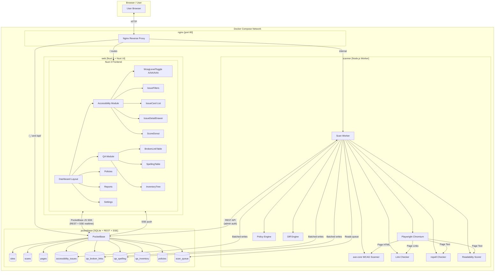

# SiteNook — SiteImprove Replacement: Full Project Brief
> Deep-dive analysis · Coding agent prompt · Architecture · Docker Compose

---

## PART 1 — SITEIMPROVE DEEP DIVE ANALYSIS

### 1.1 Accessibility Module

SiteImprove Accessibility is a continuous automated scanning platform that crawls live websites and surfaces violations against the Web Content Accessibility Guidelines (WCAG). Its key capabilities are:

**WCAG Coverage**
- Audits WCAG 2.0, 2.1, and 2.2 at all three conformance levels: A, AA, and AAA.
- Each issue is tagged with its exact Success Criterion (e.g. SC 1.4.3 Contrast Minimum — AA).
- Issues are further categorised as *Errors* (automated certainty), *Warnings* (likely violations requiring review), and *Reviews* (manual checks axe-like tooling cannot automate).
- Also checks WAI-ARIA authoring practices: missing roles, invalid `aria-*` attributes, and orphaned landmark regions.
- Best-practice checks beyond WCAG (e.g. "every page should have one `<h1>`").
- Automated coverage sits around 40–57% of all possible WCAG violations; the remainder requires manual testing.

**Dashboard & Filtering UI**
- Accessibility Overview page shows a composite **DCI (Digital Certainty Index) score** (0–100).
- Conformance toggle: A → AA → AAA (single or stacked selection).
- Filter bar: conformance level, WCAG version, issue type (error/warning/review), responsibility (developer/editor/designer), element type (image, form, link, heading, table, etc.).
- Per-page breakdown: every crawled URL gets its own score and issue count.
- Issue detail pane: affected HTML element highlighted in a mini-preview, code snippet, "why this matters" explanation, link to the relevant WCAG technique, suggested fix with code snippet.
- Trend charts: score over time, issue count over time (useful for showing progress to leadership).
- PDF tagging: accessibility scanning is extended to uploaded PDF documents.
- CMS plugins (Drupal, AEM) add *PrePublish* checks that run before content is saved.

**Roles & Workflow**
- Role selector: Developer / Editor / Designer — filters issues by who is responsible for the fix.
- Jira integration: one-click creation of Jira tickets from any issue.
- Dismissal workflow: confirm, dismiss, undo.
- Manual testing guidance: 24 assisted manual tests mapped to WCAG 2.1 AA, with keyboard navigation walkthroughs.

---

### 1.2 Quality Assurance (QA) Module

**Broken Links**
- Crawls all internal and external hyperlinks on every page and in every PDF.
- Statuses: Broken (4xx/5xx), Redirected, Dismissed.
- Page-level view: "pages with most broken links" sorted descending.
- Link-level view: one broken URL → all pages it appears on (fix once, clear everywhere).
- Prioritisation by page views / page level so high-traffic issues surface first.
- Trend graph updated after each crawl.
- Dismissed Links widget (can be added to dashboard).

**Spelling & Misspellings**
- Multi-language spell-check across page text content.
- Two tiers: *Misspellings* (high confidence) and *Words to Review* (potential errors).
- Custom dictionaries: add brand names, jargon, proper nouns to an allowlist.
- Flags: word in context, page URL, surrounding paragraph.

**Content Inventory**
- Full crawl inventory: pages, files, images, PDFs, downloadable documents.
- Sitemap / folder-tree view of site structure.
- Readability scores (Flesch-Kincaid or similar) per page.
- Duplicate content detection (pages with hreflang tags can be excluded).
- Content freshness / last-modified tracking.

**Policy (Custom Rules)**
- Regex or keyword-based rules that fire during each crawl.
- Detects outdated branding, removed employee names, unsafe domains, deprecated HTML.
- Covers QA, Accessibility, SEO, and Analytics.
- Bulk re-check button after edits.

**Reporting & Integrations**
- Configurable dashboard widgets (drag-and-drop, cross-site view).
- Scheduled email digests (every 5 days default).
- Jira issue creation from any QA finding.
- DCI score export widget.
- CMS integrations: Drupal, Adobe AEM, Jahia, WordPress.

---

### 1.3 What SiteImprove Does NOT Do Well (Gaps to Exploit)

| Gap | Our Opportunity |
|-----|----------------|
| Expensive SaaS (per-domain pricing) | Self-hosted, unlimited domains, one flat Docker deploy |
| Closed-source, no API extensibility | PocketBase REST + realtime + open schema |
| Slow crawl scheduling (hourly minimum) | On-demand scan + scheduled CRON via worker |
| No element-level diff between scans | Persist raw scan JSON → diff violations run-to-run |
| No CI/CD native integration | REST API endpoint + GitHub Action / CLI tool |
| No A/AA/AAA toggle with live count | Built-in tabbed WCAG level filter with live issue counter |
| PDF accessibility requires upload | Crawl-detected PDFs auto-queued for scan |
| Manual tests buried in UI | Checklist module with guided manual review steps |

---

## PART 2 — TECH STACK DECISION

### 2.1 Database: PocketBase ✅ (Recommended)

PocketBase (https://github.com/pocketbase/pocketbase) is a single-binary Go backend that bundles:
- SQLite database with full-text search
- REST + realtime API (Server-Sent Events)
- Built-in admin UI at `/\_/`
- Authentication (email/password, OAuth2, API keys)
- File storage (local or S3-compatible)
- Migrations as Go or JS hooks
- Zero external dependencies — ideal for Docker

**Why PocketBase over alternatives:**

| Feature | PocketBase | Supabase | Directus | Raw Postgres |
|---------|-----------|---------|---------|-------------|
| Single binary / container | ✅ | ❌ (multi-service) | ❌ | ❌ |
| Built-in auth | ✅ | ✅ | ✅ | ❌ |
| Realtime | ✅ SSE | ✅ | ✅ | ❌ |
| Admin UI included | ✅ | ✅ | ✅ | ❌ |
| Docker simplicity | ✅ 1 container | ⚠️ 5+ containers | ⚠️ 3+ containers | ⚠️ |
| No external DB needed | ✅ | ❌ | ❌ | — |

> **Verdict:** PocketBase is the correct choice for a self-hosted Docker Compose project. One container, zero configuration database.

---

## PART 3 — PROJECT ARCHITECTURE (GRAPHIFY MAP)

```
sitenook/
├── docker-compose.yml              # Orchestrates all services
├── .env.example                    # Environment variable template
├── README.md
│
├── apps/
│   ├── web/                        # Nuxt 3 + Nuxt UI dashboard (frontend)
│   │   ├── app/
│   │   │   ├── layouts/
│   │   │   │   └── dashboard.vue   # Sidebar + topbar shell
│   │   │   ├── pages/
│   │   │   │   ├── index.vue                  # Home / overview
│   │   │   │   ├── sites/
│   │   │   │   │   ├── index.vue              # All sites list
│   │   │   │   │   └── [id]/
│   │   │   │   │       ├── index.vue          # Site overview
│   │   │   │   │       ├── accessibility/
│   │   │   │   │       │   ├── index.vue      # WCAG dashboard + toggle
│   │   │   │   │       │   └── [issueId].vue  # Issue detail
│   │   │   │   │       └── qa/
│   │   │   │   │           ├── index.vue      # QA overview
│   │   │   │   │           ├── links.vue      # Broken links
│   │   │   │   │           ├── spelling.vue   # Misspellings
│   │   │   │   │           └── inventory.vue  # Page inventory
│   │   │   │   ├── scans/
│   │   │   │   │   ├── index.vue              # Scan history
│   │   │   │   │   └── [scanId].vue           # Scan detail / diff
│   │   │   │   ├── policies/
│   │   │   │   │   ├── index.vue              # Custom rules list
│   │   │   │   │   └── [id].vue               # Edit policy
│   │   │   │   ├── reports/
│   │   │   │   │   └── index.vue              # Export & scheduled reports
│   │   │   │   └── settings/
│   │   │   │       ├── index.vue              # General settings
│   │   │   │       ├── users.vue              # Team members
│   │   │   │       └── integrations.vue       # Webhooks, Jira, Slack
│   │   │   ├── components/
│   │   │   │   ├── accessibility/
│   │   │   │   │   ├── WcagLevelToggle.vue    # A / AA / AAA / All tabs
│   │   │   │   │   ├── IssueCard.vue          # Single violation card
│   │   │   │   │   ├── IssueDetailDrawer.vue  # Slide-out with code + fix
│   │   │   │   │   ├── ScoreDonut.vue         # DCI-style score ring
│   │   │   │   │   ├── IssueFilters.vue       # Role, element type, status
│   │   │   │   │   └── TrendChart.vue         # Recharts score over time
│   │   │   │   ├── qa/
│   │   │   │   │   ├── BrokenLinkTable.vue
│   │   │   │   │   ├── SpellingTable.vue
│   │   │   │   │   └── InventoryTree.vue
│   │   │   │   └── shared/
│   │   │   │       ├── SiteSelector.vue
│   │   │   │       ├── ScanTriggerButton.vue
│   │   │   │       └── StatusBadge.vue
│   │   │   └── composables/
│   │   │       ├── usePocketBase.ts
│   │   │       ├── useAccessibility.ts
│   │   │       └── useQA.ts
│   │   ├── nuxt.config.ts
│   │   ├── package.json
│   │   └── Dockerfile
│   │
│   └── scanner/                    # Node.js scan worker (Playwright + axe-core)
│       ├── src/
│       │   ├── index.ts            # Worker entry — polls PocketBase queue
│       │   ├── crawler/
│       │   │   ├── siteCrawler.ts  # BFS link crawler with Playwright
│       │   │   └── linkChecker.ts  # HTTP HEAD checks for broken links
│       │   ├── accessibility/
│       │   │   ├── axeRunner.ts    # axe-core per-page runner
│       │   │   ├── wcagMapper.ts   # Maps axe tags → WCAG level/SC
│       │   │   └── diffEngine.ts   # Compares two scan results
│       │   ├── qa/
│       │   │   ├── spellChecker.ts # nspell integration
│       │   │   ├── readability.ts  # Flesch-Kincaid scorer
│       │   │   └── policyEngine.ts # Custom regex rules
│       │   └── db/
│       │       └── pocketbaseClient.ts
│       ├── package.json
│       └── Dockerfile
│
├── services/
│   └── pocketbase/
│       ├── Dockerfile
│       └── pb_migrations/          # Schema migrations
│           ├── 001_sites.js
│           ├── 002_scans.js
│           ├── 003_issues.js
│           ├── 004_qa_results.js
│           └── 005_policies.js
│
└── nginx/
    ├── nginx.conf                  # Reverse proxy: / → web, /api → pocketbase
    └── Dockerfile
```

---

## PART 4 — DATABASE SCHEMA (PocketBase Collections)

```
sites
  id, name, url, description, created, updated
  owner (relation → users)
  crawl_schedule (text: "daily"|"weekly"|"manual")
  custom_headers (json)
  auth_config (json: for password-protected sites)

scans
  id, site (relation → sites), status ("queued"|"running"|"complete"|"failed")
  scan_type ("full"|"accessibility_only"|"qa_only")
  pages_crawled (number), started_at, completed_at
  wcag_version ("2.1"|"2.2")
  score_a (number 0–100), score_aa (number), score_aaa (number), score_qa (number)
  raw_config (json)

pages
  id, scan (relation → scans), site (relation → sites)
  url, title, status_code, last_modified
  word_count, readability_score
  crawl_depth (number)

accessibility_issues
  id, scan (relation → scans), page (relation → pages)
  rule_id (text: axe rule id e.g. "color-contrast")
  wcag_level ("A"|"AA"|"AAA")
  wcag_sc (text: e.g. "1.4.3")
  wcag_version ("2.0"|"2.1"|"2.2")
  impact ("critical"|"serious"|"moderate"|"minor")
  type ("error"|"warning"|"review")
  element_type (text: "image"|"form"|"link"|"heading"|"table"|"media"|"other")
  responsible_role ("developer"|"editor"|"designer")
  help_url (text)
  description (text)
  html_snippet (text)
  css_selector (text)
  fix_suggestion (text)
  status ("open"|"dismissed"|"fixed")
  dismissed_by (relation → users), dismissed_at

qa_broken_links
  id, scan (relation → scans), page (relation → pages)
  href (text), status_code (number), link_type ("internal"|"external")
  status ("broken"|"redirected"|"dismissed")

qa_spelling
  id, scan (relation → scans), page (relation → pages)
  word (text), context (text), confidence ("error"|"review")
  status ("open"|"dismissed"|"false_positive")

qa_inventory
  id, scan (relation → scans), url, content_type, size_bytes
  mime_type, is_pdf (bool), pdf_accessibility_score (number)

policies
  id, site (relation → sites), name, description
  rule_type ("keyword"|"regex"|"html_attribute")
  pattern (text), category ("qa"|"accessibility"|"brand")
  severity ("error"|"warning"), enabled (bool)

policy_matches
  id, scan (relation → scans), policy (relation → policies)
  page (relation → pages), matched_text, context, status

scan_queue
  id, site (relation → sites), priority (number), requested_by (relation → users)
  scan_type, status ("pending"|"processing")
```

---

## PART 5 — CODING AGENT PROMPT

```
=============================================================================
CODING AGENT PROMPT — SiteNook: Open-Source SiteImprove Replacement
=============================================================================

You are a senior full-stack developer. Build a production-ready, 
self-hosted web accessibility and QA monitoring platform called "SiteNook" 
that replicates and improves upon SiteImprove's Accessibility and QA modules.

─────────────────────────────────────────────────────────────────────────────
TECH STACK (non-negotiable)
─────────────────────────────────────────────────────────────────────────────

Frontend:     Nuxt 3 (latest) using the nuxt-ui-templates/dashboard template
              https://github.com/nuxt-ui-templates/dashboard
              Nuxt UI v2 (all components must use UButton, UTable, UCard, 
              UBadge, USlideover, UModal, etc.)
              Nuxt UI Pro dashboard layout (sidebar + topbar pattern)
              TailwindCSS (via Nuxt UI)
              Recharts (via @nuxtjs/recharts or vue-chartjs) for charts
              VueUse for composables
              PocketBase JS SDK (pocketbase npm package) for data layer

Scanner:      Node.js 20+ TypeScript worker
              Playwright (chromium headless, no-sandbox in Docker)
              axe-core (@axe-core/playwright) for WCAG scanning
              nspell for spell checking
              node-readability or text-readability for Flesch-Kincaid
              p-queue for concurrency control

Backend/DB:   PocketBase latest (single binary in Docker)
              SQLite (embedded, no external DB required)
              PocketBase hooks (JS) for scan queue processing triggers

Proxy:        Nginx (alpine) — routes / → Nuxt, /_/ and /api → PocketBase

Orchestration: Docker Compose v3.9
               Services: web, scanner, pocketbase, nginx
               All secrets via .env file (never hardcoded)

─────────────────────────────────────────────────────────────────────────────
PROJECT STRUCTURE
─────────────────────────────────────────────────────────────────────────────

Clone the nuxt-ui-templates/dashboard template as the starting point for 
apps/web/. Adapt its layout, navigation, and components. Do NOT start from 
scratch — the template provides the sidebar nav, dark mode toggle, user menu, 
notification bell, and responsive shell.

Lay out the repo exactly as follows:

  sitenook/
  ├── docker-compose.yml
  ├── docker-compose.override.yml     (dev overrides: hot reload, bind mounts)
  ├── .env.example
  ├── README.md
  ├── apps/
  │   ├── web/                        (Nuxt 3 frontend)
  │   └── scanner/                    (Node.js worker)
  ├── services/
  │   └── pocketbase/
  │       ├── Dockerfile
  │       └── pb_migrations/
  └── nginx/
      ├── nginx.conf
      └── Dockerfile

─────────────────────────────────────────────────────────────────────────────
DOCKER COMPOSE
─────────────────────────────────────────────────────────────────────────────

version: "3.9"
services:
  nginx:
    image: nginx:alpine
    ports: ["80:80"]
    depends_on: [web, pocketbase]
    volumes: [./nginx/nginx.conf:/etc/nginx/nginx.conf:ro]

  web:
    build: ./apps/web
    environment:
      NUXT_PUBLIC_POCKETBASE_URL: http://pocketbase:8090
    depends_on: [pocketbase]

  scanner:
    build: ./apps/scanner
    environment:
      POCKETBASE_URL: http://pocketbase:8090
      POCKETBASE_ADMIN_EMAIL: ${PB_ADMIN_EMAIL}
      POCKETBASE_ADMIN_PASSWORD: ${PB_ADMIN_PASSWORD}
      CONCURRENCY: 3                  # parallel pages per scan
      MAX_PAGES_PER_SCAN: 500
    depends_on: [pocketbase]
    shm_size: "2gb"                   # required for Playwright Chromium

  pocketbase:
    build: ./services/pocketbase
    volumes:
      - pb_data:/pb/pb_data
    environment:
      PB_ADMIN_EMAIL: ${PB_ADMIN_EMAIL}
      PB_ADMIN_PASSWORD: ${PB_ADMIN_PASSWORD}

volumes:
  pb_data:

The development override (docker-compose.override.yml) must:
- Mount apps/web as a bind volume with `nuxt dev --host 0.0.0.0`
- Mount apps/scanner with ts-node-dev / tsx watch
- Expose PocketBase port 8090 on localhost for direct admin access
- Expose Nuxt port 3000 on localhost

─────────────────────────────────────────────────────────────────────────────
NUXT UI DASHBOARD — NAVIGATION & LAYOUT
─────────────────────────────────────────────────────────────────────────────

Use the template's dashboard layout. The left sidebar navigation must be:

  ╔══════════════════════════╗
  ║  🔍 SiteNook             ║  (logo + wordmark)
  ╠══════════════════════════╣
  ║  ⌂  Overview             ║
  ║  🌐  Sites               ║
  ╠══ [active site dropdown] ╣
  ║  ♿  Accessibility        ║
  ║  ✅  Quality Assurance   ║
  ║     ↳ Broken Links       ║
  ║     ↳ Spelling           ║
  ║     ↳ Inventory          ║
  ║  📊  Reports             ║
  ║  📋  Policies            ║
  ╠══════════════════════════╣
  ║  ⚙️  Settings            ║
  ║     ↳ Sites              ║
  ║     ↳ Team               ║
  ║     ↳ Integrations       ║
  ╚══════════════════════════╝

The topbar must show:
- Active site name + URL (with a dropdown to switch sites)
- "Scan Now" button (UButton primary, triggers immediate scan via API)
- Last scan timestamp ("Last scanned 2h ago")
- Notification bell (recent scan completions, new critical issues)
- User avatar menu (profile, logout)

─────────────────────────────────────────────────────────────────────────────
ACCESSIBILITY MODULE — DETAILED SPEC
─────────────────────────────────────────────────────────────────────────────

PAGE: /sites/[id]/accessibility

SECTION 1 — Score Header
  - Large animated donut chart (ScoreDonut.vue) showing composite score 0–100
  - Score is calculated as: (1 - violations/total_checks) * 100 weighted by impact
  - Critical = weight 4, Serious = 3, Moderate = 2, Minor = 1
  - Show scores for each WCAG level separately (three smaller donuts: A, AA, AAA)
  - Last scan date + "Scan Now" button
  - Trend sparkline (30 days)

SECTION 2 — WCAG Level Toggle (WcagLevelToggle.vue)
  This is the CORE UI element. Build it as a segmented tab bar:

  ┌──────┬──────┬───────┬──────────┐
  │ All  │  A   │  AA   │  AAA     │
  │ (92) │ (12) │ (47)  │  (33)    │
  └──────┴──────┴───────┴──────────┘

  - Each tab shows the live issue count as a badge
  - Selecting a tab filters the issue list AND updates the score donut
  - "All" shows every issue regardless of level
  - Badge colours: A = red (critical), AA = orange, AAA = yellow
  - Toggle is persistent in URL query param: ?level=AA

SECTION 3 — Filter Bar (IssueFilters.vue)
  Horizontal filter row below the toggle:
  
  [WCAG Version ▾]  [Impact ▾]  [Type ▾]  [Element ▾]  [Role ▾]  [Status ▾]
  
  - WCAG Version: 2.0 / 2.1 / 2.2 (multi-select)
  - Impact: Critical / Serious / Moderate / Minor (colour-coded chips)
  - Type: Error / Warning / Review
  - Element: Image / Form / Link / Heading / Table / Media / ARIA / Other
  - Role: Developer / Editor / Designer
  - Status: Open / Dismissed / Fixed
  - Active filters shown as dismissible chips below the row
  - "Clear all filters" link when any filter is active
  - Total count: "Showing 47 of 92 issues"

SECTION 4 — Issue List
  Virtualised list (vue-virtual-scroller) for large scan results.
  Each IssueCard.vue shows:
  
  ┌────────────────────────────────────────────────────────────┐
  │ [●] CRITICAL  │ AA  │ SC 1.4.3  │ color-contrast          │
  │ Image: Missing alternative text                            │
  │              │
  │ .hero-image > img                          [Fix] [Dismiss] │
  └────────────────────────────────────────────────────────────┘
  
  - Colour-coded left border: red=critical, orange=serious, yellow=moderate, grey=minor
  - WCAG level badge (UBadge): A / AA / AAA
  - Success Criterion number (e.g. "SC 2.4.6") links to w3.org
  - Axe rule ID shown in monospace
  - Short description of the violation
  - HTML snippet in syntax-highlighted <code> block (max 3 lines, expandable)
  - CSS selector path
  - [Fix] button opens IssueDetailDrawer
  - [Dismiss] button with confirmation popover (requires reason)

SECTION 5 — IssueDetailDrawer.vue (USlideover, right-side)
  Opens when [Fix] is clicked. Shows:
  
  Header:
    - Rule name + WCAG level badge + impact badge
    - SC number with link to WCAG docs
    - "Open in new tab" link to the affected page URL
  
  Tabs: [Overview] [Code] [How to Fix] [Resources]
  
  Overview tab:
    - "Why this matters" — human-readable explanation of who is affected
    - Affected users: lists disability types impacted (e.g. "Users with low vision")
    - Element preview: renders the raw HTML snippet in an isolated iframe
    - Page URL + heading path (breadcrumb of headings to locate the issue)
  
  Code tab:
    - Full highlighted HTML snippet with the offending element highlighted
    - CSS selector (copyable)
    - DOM path breadcrumb
  
  How to Fix tab:
    - Step-by-step written fix instructions
    - "Before" code block (the current broken code)
    - "After" code block (the corrected code)
    - One-click copy for the fix snippet
  
  Resources tab:
    - Link to the specific WCAG 2.x Success Criterion on w3.org
    - Link to the axe-core rule documentation
    - Link to MDN docs for the element type
    - Related WCAG techniques (sufficient + advisory)
  
  Footer:
    - [Mark as Fixed] (sets status = "fixed", removes from open list)
    - [Dismiss] with dropdown: "Won't fix", "False positive", "Defer"
    - Dismissed issues are hidden from default view but accessible via Status filter

PAGE: /sites/[id]/accessibility — Per-Page Breakdown
  Secondary tab on the accessibility page: "By Page"
  Table columns: Page URL | A Issues | AA Issues | AAA Issues | Score | Last Scanned
  Clicking a row drills into that page's issue list (pre-filtered by URL)

─────────────────────────────────────────────────────────────────────────────
QUALITY ASSURANCE MODULE — DETAILED SPEC
─────────────────────────────────────────────────────────────────────────────

PAGE: /sites/[id]/qa

QA Overview shows four status rings (like SiteImprove's DCI widgets):
  [ Broken Links: 12 ]  [ Misspellings: 8 ]  [ Policies: 3 ]  [ Readability: 74 ]

Each ring is green (0 issues) / amber (1–10) / red (10+).
Click any ring to navigate to that sub-section.

─── BROKEN LINKS (/qa/links) ───

View toggle: [Pages View] [Links View]

Pages View (default):
  Table: Page URL | # Broken Links | Last Crawled | Actions
  Sorted by broken link count descending.
  Each row expandable to show the broken URLs on that page.

Links View:
  Table: Broken URL | HTTP Status | Type | # Pages Affected | Actions
  A single broken URL appearing on 40 pages shows once — fix it in one action.

Link detail:
  - The broken href
  - HTTP status code (with badge: 404=red, 500=orange, 301=blue)
  - Type: internal / external
  - All pages containing this link (collapsible)
  - [Dismiss] / [Mark as Fixed] / [Confirm Broken] actions

─── SPELLING (/qa/spelling) ───

Two tabs: [Misspellings] [Words to Review]

Table: Word | Context (surrounding sentence) | Page URL | Occurrences | Actions
Actions per row: [Correct] (opens CMS link) / [Add to Dictionary] / [Dismiss]

Custom Dictionary panel (right sidebar or modal):
  - List of allowed words (brand terms, product names)
  - Add word field + language selector

─── INVENTORY (/qa/inventory) ───

Tab bar: [Pages] [Files] [Images] [PDFs]

Pages tab:
  Table: URL | Title | Status Code | Word Count | Readability | Depth | Last Modified
  Sortable by each column.
  
Files tab:
  Table: URL | Type | Size | Mime Type | Linked From | Last Seen

PDFs tab:
  Table: URL | Size | Pages | Accessibility Score | Issues | Actions
  [Scan Accessibility] button queues PDF-specific axe scan.

─────────────────────────────────────────────────────────────────────────────
POLICIES MODULE — DETAILED SPEC
─────────────────────────────────────────────────────────────────────────────

PAGE: /policies

List view: cards per policy with name, pattern, category badge, enabled toggle, last match count.

Create/Edit Policy modal:
  Fields:
    - Name (text)
    - Description (textarea)
    - Category: QA / Brand / Accessibility / Security
    - Rule Type: Keyword / Regex / HTML Attribute
    - Pattern (text, with test input to validate the regex live)
    - Severity: Error / Warning
    - Applies to: All Sites / Selected Sites (multi-select)
    - Enabled toggle

Policy Matches page (/policies/[id]):
  Table: Page URL | Matched Text | Context | Last Seen | Status

─────────────────────────────────────────────────────────────────────────────
SCANNER WORKER — DETAILED SPEC
─────────────────────────────────────────────────────────────────────────────

The scanner is a long-running Node.js TypeScript process that:

1. On startup, authenticates to PocketBase as admin.
2. Polls the scan_queue collection every 10 seconds for pending items.
3. When a queue item is found, sets status = "processing" (row lock via PocketBase API).
4. Launches a Playwright chromium browser (--no-sandbox for Docker).
5. Crawls the site using BFS up to MAX_PAGES_PER_SCAN pages.
6. For each page:
   a. Navigates with Playwright.
   b. Runs axe-core with all WCAG tags:
      tags: ['wcag2a','wcag2aa','wcag2aaa','wcag21a','wcag21aa','wcag21aaa','wcag22a','wcag22aa','wcag22aaa','best-practice']
   c. Maps each violation to its WCAG level, Success Criterion, impact, element type, responsible role.
   d. Checks all links on the page (HEAD requests, 5s timeout).
   e. Extracts text content, runs spell checker, computes readability score.
   f. Saves results to PocketBase in batches of 50 records.
7. After all pages are processed:
   a. Runs policy engine against page HTML snapshots.
   b. Calculates aggregate scores per WCAG level.
   c. Updates the scan record: status = "complete", scores, completed_at.
   d. Creates a diff record comparing to the previous scan (new issues, fixed issues).
8. Emits a PocketBase event that triggers real-time update to connected dashboard clients.

WCAG level mapping (axe tag → level):
  wcag2a, wcag21a, wcag22a  →  Level A
  wcag2aa, wcag21aa, wcag22aa  →  Level AA
  wcag2aaa, wcag21aaa, wcag22aaa  →  Level AAA

Responsible role heuristic:
  Image alt text, heading order, link text  →  Editor
  Color contrast, ARIA, keyboard, focus order  →  Developer
  Color palette decisions, focus indicator design  →  Designer

─────────────────────────────────────────────────────────────────────────────
REPORTS MODULE
─────────────────────────────────────────────────────────────────────────────

PAGE: /reports

Schedule Report modal:
  - Report type: Accessibility Summary / QA Summary / Full Report
  - Frequency: Daily / Weekly / Monthly
  - Recipients: email list (tags input)
  - Format: PDF / CSV / JSON
  - WCAG scope: A only / A+AA / All levels

Instant Export:
  - [Export CSV] button on any issue table
  - [Export PDF] button generates a print-friendly accessibility report
    (uses Nuxt's built-in print CSS or a headless PDF generation route)

─────────────────────────────────────────────────────────────────────────────
POCKETBASE SCHEMA MIGRATIONS
─────────────────────────────────────────────────────────────────────────────

Create all collections as PocketBase JS migrations in services/pocketbase/pb_migrations/.
Use the exact schema defined in Part 4 of this brief.
Each migration file must be idempotent.

─────────────────────────────────────────────────────────────────────────────
ENVIRONMENT VARIABLES (.env.example)
─────────────────────────────────────────────────────────────────────────────

PB_ADMIN_EMAIL=admin@sitenook.local
PB_ADMIN_PASSWORD=changeme_strong_password_here
NUXT_PUBLIC_POCKETBASE_URL=http://pocketbase:8090
NUXT_PUBLIC_APP_URL=http://localhost
SCANNER_CONCURRENCY=3
SCANNER_MAX_PAGES=500
SCANNER_POLL_INTERVAL_MS=10000

─────────────────────────────────────────────────────────────────────────────
REALTIME UPDATES
─────────────────────────────────────────────────────────────────────────────

Use PocketBase's realtime (SSE) subscriptions in the Nuxt frontend:
- Subscribe to scans collection: update progress bar in topbar and scan detail page
- Subscribe to scan_queue: update "Scan in Progress" indicator
- usePocketBase composable must expose: useRealtimeScan(scanId) which returns
  a reactive ref to the current scan record, auto-updating via SSE.

─────────────────────────────────────────────────────────────────────────────
AUTHENTICATION
─────────────────────────────────────────────────────────────────────────────

Use PocketBase's built-in users collection.
- Login page: /login — email + password, remember me
- Auth token stored in httpOnly cookie (PocketBase cookie auth)
- Nuxt middleware: auth.ts — redirects unauthenticated users to /login
- Settings > Team: invite users by email, assign role (Admin / Analyst / Viewer)
  - Admin: full access including adding sites and managing users
  - Analyst: can trigger scans, dismiss issues, create policies
  - Viewer: read-only access to reports and dashboards

─────────────────────────────────────────────────────────────────────────────
DESIGN SYSTEM (Nuxt UI)
─────────────────────────────────────────────────────────────────────────────

Follow the nuxt-ui-templates/dashboard visual language exactly:
- Use UDashboardLayout, UDashboardSidebar, UDashboardNavbar, UDashboardPage
- Dark mode: fully supported via Nuxt UI's dark mode toggle
- Colours: 
  - Critical issues: red-500
  - Serious: orange-500  
  - Moderate: yellow-500
  - Minor: gray-400
  - WCAG Level A badge: red bg
  - WCAG Level AA badge: orange bg
  - WCAG Level AAA badge: yellow bg
  - Score > 80: green-500, Score 60–80: amber-500, Score < 60: red-500
- Typography: use Nuxt UI defaults (Inter / system-ui)
- All tables: UTable with sortable columns and row click
- All modals: UModal
- All drawers: USlideover (right side)
- All toasts: useToast() composable for scan complete, error, dismiss confirmations

─────────────────────────────────────────────────────────────────────────────
NGINX CONFIGURATION
─────────────────────────────────────────────────────────────────────────────

  upstream web { server web:3000; }
  upstream pocketbase { server pocketbase:8090; }

  server {
    listen 80;
    location /_/ { proxy_pass http://pocketbase; }
    location /api/ { proxy_pass http://pocketbase; }
    location / { 
      proxy_pass http://web;
      proxy_http_version 1.1;
      proxy_set_header Upgrade $http_upgrade;
      proxy_set_header Connection "upgrade";  # for HMR in dev
    }
  }

─────────────────────────────────────────────────────────────────────────────
EXISTING PROJECT CLEANUP INSTRUCTIONS
─────────────────────────────────────────────────────────────────────────────

When the agent encounters an existing project to migrate:

1. IDENTIFY: Scan the root for any existing frontend framework files 
   (package.json, nuxt.config.ts, next.config.js, vite.config.ts).
2. MOVE: Any existing Nuxt app files → apps/web/ preserving their structure.
3. MOVE: Any existing Node.js API / worker code → apps/scanner/ or a new 
   apps/api/ service as appropriate.
4. REMOVE: Any standalone docker-compose.yml at the root (replace with the 
   new multi-service version).
5. RENAME: pages/ → app/pages/ to match Nuxt 3 app directory convention.
6. REMOVE: .nuxt/, node_modules/, dist/ directories (regenerated on build).
7. UPDATE: nuxt.config.ts — ensure it uses Nuxt UI module and PocketBase SDK.
8. ADD: apps/web/.env.example, apps/scanner/.env.example
9. CONSOLIDATE: Any existing .env files into the root .env following the 
   template in this brief.
10. README: Replace any existing README with a new one covering:
    - Architecture overview
    - Quick start (docker compose up)
    - Development setup
    - Environment variable reference
    - How to add a new site
    - How to write a custom policy

─────────────────────────────────────────────────────────────────────────────
DELIVERABLES CHECKLIST
─────────────────────────────────────────────────────────────────────────────

The agent must produce:

[ ] docker-compose.yml + docker-compose.override.yml
[ ] .env.example
[ ] apps/web/ — full Nuxt 3 app based on nuxt-ui-templates/dashboard
    [ ] All pages listed in the navigation spec
    [ ] WcagLevelToggle.vue with live issue counts
    [ ] IssueCard.vue with colour-coded severity border
    [ ] IssueDetailDrawer.vue with 4 tabs
    [ ] IssueFilters.vue with all filter dimensions
    [ ] ScoreDonut.vue animated ring chart
    [ ] TrendChart.vue (30-day score history)
    [ ] BrokenLinkTable.vue (pages view + links view toggle)
    [ ] SpellingTable.vue with custom dictionary
    [ ] InventoryTree.vue (pages/files/images/PDFs tabs)
    [ ] usePocketBase.ts composable
    [ ] useRealtimeScan(scanId) composable
    [ ] Auth middleware
[ ] apps/scanner/ — Node.js TypeScript worker
    [ ] Playwright + axe-core WCAG scanner
    [ ] BFS site crawler with concurrency control
    [ ] Link checker (HEAD requests)
    [ ] Spell checker (nspell)
    [ ] Readability scorer
    [ ] Policy engine (regex/keyword)
    [ ] Diff engine (new vs fixed issues between scans)
    [ ] PocketBase client with queue polling
[ ] services/pocketbase/
    [ ] Dockerfile
    [ ] pb_migrations/ for all collections
[ ] nginx/
    [ ] nginx.conf
    [ ] Dockerfile
[ ] README.md with full setup guide

=============================================================================
END OF CODING AGENT PROMPT
=============================================================================
```

---

## PART 6 — GRAPHIFY PROJECT MAP (Mermaid)



---

## PART 7 — OPEN-SOURCE LIBRARIES REFERENCE

| Purpose | Library | Notes |
|---------|---------|-------|
| WCAG scanning | `axe-core` + `@axe-core/playwright` | Industry standard, 4B+ downloads, WCAG 2.0/2.1/2.2 A/AA/AAA |
| Browser automation | `playwright` | Headless Chromium in Docker |
| Spell checking | `nspell` | Pure JS, multi-language, custom dictionaries |
| Readability | `text-readability` or `flesch` | Flesch-Kincaid, Gunning Fog |
| Link checking | Native `fetch` with HEAD | No extra lib needed |
| Concurrency | `p-queue` | Limit concurrent page scans |
| DB + auth | `pocketbase` (JS SDK) | REST + SSE client |
| Frontend framework | `nuxt` v3 | |
| UI components | `@nuxt/ui` v2 | Tailwind-based, dark mode |
| Charts | `vue-chartjs` + `chart.js` | Donut, line, bar charts |
| Virtual list | `vue-virtual-scroller` | For large issue lists |
| Date formatting | `date-fns` | |
| Syntax highlight | `shiki` or `prism-vue3` | Code snippets in issue drawer |

---

## PART 8 — QUICK START (Post-Build)

```bash
# 1. Clone and configure
git clone <repo> sitenook && cd sitenook
cp .env.example .env
# Edit .env: set PB_ADMIN_EMAIL and PB_ADMIN_PASSWORD

# 2. Build and start all services
docker compose up -d --build

# 3. Open the app
open http://localhost

# 4. PocketBase admin (direct access in dev)
open http://localhost:8090/_/

# 5. Development mode (hot reload)
docker compose -f docker-compose.yml -f docker-compose.override.yml up
```

---

*Generated by SiteNook Project Brief — May 2026*