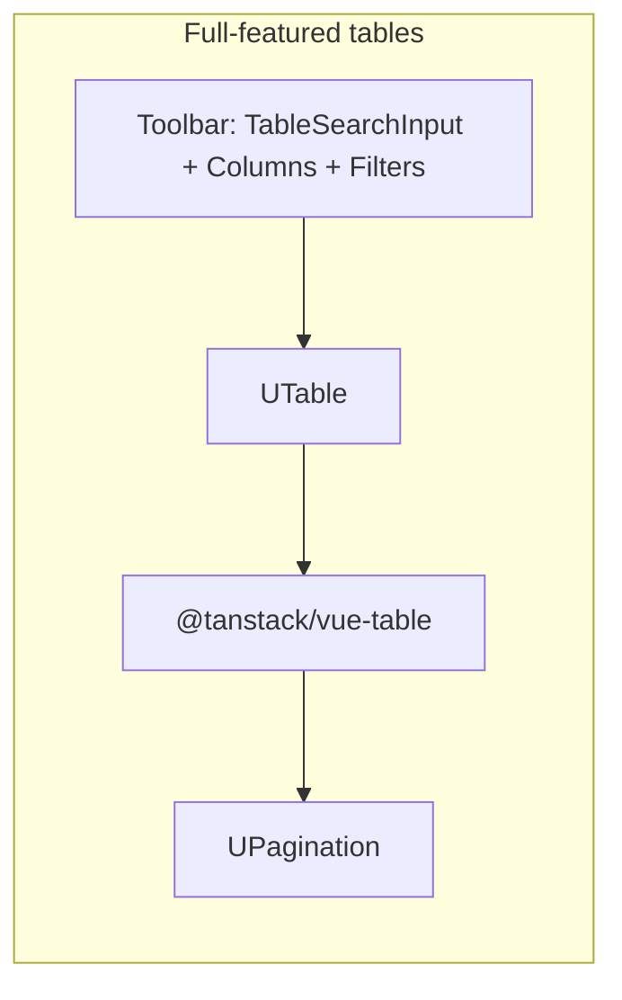

# Tables

AccessIQ uses two table patterns in the Nuxt dashboard: **Nuxt UI `UTable`** (backed by TanStack Table) for rich data grids, and **hand-written `<table>` elements** where the layout is fixed or needs custom expand-row behavior. This document covers styling, search, column visibility toggling, and sorting as implemented today.

## Where tables appear

| Component | Location | Pattern | Search | Columns toggle | Sort |
|-----------|----------|---------|--------|----------------|------|
| `IssuesTable.vue` | Accessibility issues, resolved, dashboard previews | `UTable` | Via parent* | Via parent* | Yes |
| `PagesBreakdownTable.vue` | Issues → By page tab | `UTable` | Via parent* | Via parent* | Yes |
| `SiteScansTable.vue` | `/scans` page | Custom HTML | Yes | Yes | No |
| `ActiveScansTable.vue` | `/scans` active panel (queue/history) | Custom HTML | No | No | No |
| `IssueAffectedPagesTable.vue` | Expanded issue rows | `UTable` (minimal) | No | No | No |
| `sites/index.vue` + `SitesTable.vue` | Sites list | `UTable` (row selection) | Yes | Yes | No |
| `BrokenLinkTable.vue`, `SpellingTable.vue` | QA pages | `UTable` (basic) | No | No | No |

The **full-featured pattern** (`IssuesTable`, `PagesBreakdownTable`) is the reference for new interactive tables. On the **Issues page** (`issues.vue`), search, Columns, Filters, and view tabs live in a shared **`DataTableToolbar`** above both tables; the table components use `hide-toolbar` and `v-model:search`. See [style-guide.md](./style-guide.md) for toolbar styling.

`SiteScansTable` uses an inline toolbar (search + Columns) but implements column visibility with `v-if` instead of TanStack.

\*Issues / By page: toolbar is on `issues.vue`, not inside each table SFC.

---

## Architecture



**Stack:**

- **Nuxt UI** `UTable` — declarative columns, slots, and `ui` styling overrides
- **TanStack Table** (`@tanstack/vue-table`) — sorting, filtering, pagination, expansion, column visibility
- **Lucide icons** via Nuxt UI icon names (`i-lucide-search`, `i-lucide-arrow-up-down`, etc.)

Column definitions use Nuxt UI’s `TableColumn<T>` type. Sortable headers and action cells are often built with Vue’s `h()` render function and `resolveComponent('UButton')` / `resolveComponent('UDropdownMenu')`.

---

## Styling

### Container and toolbar

Full-featured tables wrap content in a panel with consistent spacing:

```html
<div class="issues-table-panel space-y-4">
  <!-- table (toolbar may live on parent page — see issues.vue) -->
  <div class="rounded-lg border border-default overflow-hidden">
    <UTable … />
  </div>
  <!-- pagination -->
</div>
```

- **`space-y-4`** — vertical gap between toolbar (if any), table, and pagination
- **`rounded-lg border border-default overflow-hidden`** — card-like frame; clips table corners

**Issues page toolbar** (`issues.vue` + `DataTableToolbar`):

```html
<DataTableToolbar>
  <template #leading>
    <AccessibilityIssuesViewTabs v-model="pageTab" />
  </template>
  <template #actions>
    <TableSearchInput v-model="tableSearch" … />
  <UDropdownMenu :items="activeColumnMenuItems">
    <TableToolbarMenuButton label="Columns" icon="i-lucide-columns-3" />
  </UDropdownMenu>
    <AccessibilityIssueFiltersMenu … />
  </template>
</DataTableToolbar>
```

- **Search** — `TableSearchInput`: always visible, `size="sm"`, `bg-elevated`, `w-44 sm:w-56`
- **Columns / Filters** — outline buttons with **leading** icons only (`i-lucide-columns-3`, `i-lucide-list-filter`); no chevron on the button face
- **View tabs** — `AccessibilityIssuesViewTabs`: bordered `UTabs` list with sliding indicator (`style-guide.md`)

**Legacy / scans:** `SiteScansTable` still uses a full-width `UInput` + Columns in its own toolbar row.

### `UTable` UI overrides

Shared overrides on interactive tables:

```ts
:ui="{
  root: 'relative w-full',
  tr: 'data-[expanded=true]:bg-elevated/50'
}"
```

Expanded rows get a subtle elevated background. Nested tables (e.g. `IssueAffectedPagesTable`) may also set `th: 'text-xs'` and `td: 'align-middle'`.

### Column alignment and typography

- **Numeric columns** — `meta: { class: { th: 'text-right tabular-nums', td: 'text-right tabular-nums' } }` so counts and scores align and use tabular figures
- **Action columns** — `meta: { class: { td: 'text-right' } }`; header often omitted or non-sortable
- **Muted secondary text** — `text-sm text-muted`
- **Links** — `text-primary hover:underline`
- **Severity / status** — semantic colors: `text-error`, `text-warning`, `text-info`, `text-success`

### WCAG level chip

`IssuesTable` and `PagesBreakdownTable` share a scoped `.wcag-chip` style (green badge for A / AA / AAA):

```css
.wcag-chip {
  display: inline-flex;
  align-items: center;
  justify-content: center;
  min-width: 22px;
  height: 18px;
  padding: 0 6px;
  border-radius: 4px;
  background: #0f3d28;
  color: #27a16a;
  font-size: 10px;
  font-weight: 600;
  line-height: 1;
}
```

### Custom HTML tables

`SiteScansTable` and `ActiveScansTable` use scoped CSS with Nuxt UI theme variables so they match the dashboard in light and dark mode:

| Token | Usage |
|-------|--------|
| `var(--ui-text-muted)` | Header text |
| `var(--ui-border)` | Row and header borders |
| `var(--ui-bg-elevated)` | Header background, selected/hover rows |

**Site scans** (`site-scans-table`): `0.875rem` body, `0.75rem 1rem` cell padding, left-aligned headers.

**Active scans** (`active-scans-table`): slightly tighter padding; **sticky thead** inside a scroll region (`scanner-info__table-scroll`) so headers stay visible while scrolling the queue.

Row selection in the active scans panel uses `.active-row--selected` and `.active-row:hover` with elevated backgrounds.

---

## Search (global filter)

### `UTable` + TanStack global filter

Used in `IssuesTable` and `PagesBreakdownTable`.

1. Declare search state (e.g. `tableSearch` ref on the page, or `defineModel('search')` on the table).
2. Bind to `UTable` with `v-model:global-filter`.
3. Bind the same value to `TableSearchInput` in the toolbar (Issues page) or inline `UInput` (e.g. `SiteScansTable`).

TanStack applies a **global filter** across row values. Columns control what is searchable via `accessorKey` or `accessorFn`:

```ts
{
  id: 'issue',
  accessorFn: row => `${row.rule_id} ${row.description}`,
  header: ({ column }) => sortableHeader(column, 'Issue'),
  // …
}
```

Combining fields in `accessorFn` lets a single search box match rule ID, description, URL text, etc., depending on column definitions.

On the Issues page, pass `footer-summary` to `IssuesTable` for the “Showing X of Y issue types (Z occurrences)” line. It renders in the **table footer** (border-top inside the table card), left-aligned; pagination stays on the right when row count exceeds `pageSize`.

Pagination totals use the **filtered** row model:

```ts
table?.tableApi?.getFilteredRowModel().rows.length
```

### Manual client-side search

`SiteScansTable` filters before render (no TanStack):

```ts
const searchQuery = ref('')

const filteredSites = computed(() => {
  const q = searchQuery.value.trim().toLowerCase()
  if (!q) return props.sites
  return props.sites.filter(
    site =>
      site.name.toLowerCase().includes(q)
      || site.url.toLowerCase().includes(q)
  )
})
```

Empty states: *"No sites match your search."*

### Toolbar visibility

`IssuesTable` accepts `hideToolbar`. Dashboard previews on the site accessibility overview pass `hide-toolbar` so compact tables omit search and column controls (data is pre-sliced to top N rows).

---

## Column toggling

Both full-featured `UTable` instances and `SiteScansTable` expose a **Columns** dropdown (`UDropdownMenu`) with checkbox items.

### TanStack-driven visibility (`UTable`)

State:

```ts
const columnVisibility = ref<Record<string, boolean>>({})
```

Bound to the table:

```html
<UTable
  v-model:column-visibility="columnVisibility"
  …
/>
```

Menu items are built from the table API after mount (via `useTemplateRef('table')`):

```ts
const columnMenuItems = computed(() => {
  const api = table.value?.tableApi
  if (!api) return []
  return api.getAllColumns()
    .filter(column => column.getCanHide())
    .map(column => ({
      label: COLUMN_LABELS[column.id] ?? upperFirst(column.id),
      type: 'checkbox' as const,
      checked: column.getIsVisible(),
      onUpdateChecked(checked: boolean) {
        api.getColumn(column.id)?.toggleVisibility(!!checked)
      },
      onSelect(e: Event) {
        e.preventDefault() // keep menu open when toggling
      }
    }))
})
```

**Human-readable labels** live in a `COLUMN_LABELS` map keyed by column `id`.

**Non-hideable columns** — set `enableHiding: false` on columns that must always show (typically **Expand** and **Actions**):

```ts
{
  id: 'expand',
  enableSorting: false,
  enableHiding: false,
  // …
}
```

### Manual visibility (`SiteScansTable`)

Column keys are typed and stored in a boolean map defaulting to all visible:

```ts
type SiteColumnKey = 'schedule' | 'nextScan' | 'lastScan' | 'qa' | 'actions'

const columnVisibility = ref<Record<SiteColumnKey, boolean>>({
  schedule: true,
  nextScan: true,
  lastScan: true,
  qa: true,
  actions: true
})
```

Headers and cells use `v-if="columnVisibility.schedule"` (etc.). Expand-row colspan uses `visibleColumnCount` so expanded content spans the correct number of columns (fixed expand + site columns + visible optional columns).

---

## Column sorting

Sorting is implemented on **`UTable` tables only** (not `SiteScansTable` or `ActiveScansTable`).

### Setup

```ts
import { getSortedRowModel } from '@tanstack/vue-table'
import type { SortingState } from '@tanstack/vue-table'

const sorting = ref<SortingState>([{ id: 'pointsToGain', desc: true }])
```

```html
<UTable
  v-model:sorting="sorting"
  :sorting-options="{ getSortedRowModel: getSortedRowModel() }"
  …
/>
```

Default sort differs by context:

| Table | Default sort |
|-------|----------------|
| `IssuesTable` (open) | `pointsToGain` descending |
| `IssuesTable` (resolved) | `resolvedAt` descending |
| `PagesBreakdownTable` | `issues` descending |

### Sortable header control

Shared helper pattern (identical in `IssuesTable` and `PagesBreakdownTable`):

```ts
function sortableHeader(column: Column<RowType, unknown>, label: string) {
  const isSorted = column.getIsSorted()
  return h(UButton, {
    color: 'neutral',
    variant: 'ghost',
    label,
    icon: isSorted
      ? (isSorted === 'asc' ? 'i-lucide-arrow-up-narrow-wide' : 'i-lucide-arrow-down-wide-narrow')
      : 'i-lucide-arrow-up-down',
    class: '-mx-2.5',
    onClick: () => column.toggleSorting(column.getIsSorted() === 'asc')
  })
}
```

**Interaction:**

- Unsorted — neutral up/down icon
- Sorted ascending — `i-lucide-arrow-up-narrow-wide`
- Sorted descending — `i-lucide-arrow-down-wide-narrow`
- Click cycles: unsorted → desc → asc (TanStack `toggleSorting` with “next direction” when already asc)

Use in column defs:

```ts
{
  accessorKey: 'wcag_level',
  header: ({ column }) => sortableHeader(column, 'Level'),
  // …
}
```

### Computed sort values

Sort on derived values by setting `id` + `accessorFn` instead of raw `accessorKey`:

```ts
{
  id: 'impact',
  accessorFn: row => IMPACT_SORT[row.impact] ?? 0, // critical > serious > moderate > minor
  header: ({ column }) => sortableHeader(column, 'Severity'),
}
```

Other computed accessors: page count, occurrence count, points to gain, resolved timestamp.

**Non-sortable columns:** `enableSorting: false` on expand, actions, and similar utility columns.

---

## Pagination and expansion

Full-featured tables also wire:

| State | Purpose |
|-------|---------|
| `pagination` | `{ pageIndex, pageSize }` — default page size 20 (`IssuesTable` accepts `pageSize` prop) |
| `expanded` | Row expand map for nested content (affected pages, per-page issue list) |

```html
<UTable
  v-model:pagination="pagination"
  v-model:expanded="expanded"
  :pagination-options="{ getPaginationRowModel: getPaginationRowModel() }"
  :expanded-options="{ getExpandedRowModel: getExpandedRowModel() }"
>
  <template #expanded="{ row }">…</template>
</UTable>
```

`UPagination` renders only when filtered row count exceeds `pageSize`, aligned right below the table.

---

## Simpler `UTable` usage

Not every table needs the full toolbar. These use `UTable` with static columns only:

- **`sites/index.vue`** — row selection checkboxes, custom cell slots (`#name-cell`, `#actions-cell`)
- **`BrokenLinkTable.vue` / `SpellingTable.vue`** — view toggles above the table; data pre-aggregated in computed properties
- **`IssueAffectedPagesTable.vue`** — nested inside expanded issue rows; compact styling, no filter/sort/columns menu

When adding a new list that only needs display (no user-driven reorder/filter), a minimal column array and optional `#column-cell` slots is enough.

---

## Adding a new full-featured table

1. Create a Vue SFC under `apps/web/app/components/…`.
2. Define `TableColumn<T>[]` (computed if columns depend on props).
3. Add refs: `globalFilter`, `sorting`, `columnVisibility`, `pagination` (and `expanded` if needed).
4. Import TanStack row models: `getSortedRowModel`, `getPaginationRowModel`, (`getExpandedRowModel` if expanding).
5. Copy the toolbar pattern from `issues.vue` (`DataTableToolbar` + `TableSearchInput` + Columns/Filters menus) or inline search for simpler pages.
6. Wrap `UTable` in `rounded-lg border border-default overflow-hidden`.
7. Implement `sortableHeader` and `COLUMN_LABELS`; set `enableHiding: false` on fixed columns.
8. Add `UPagination` guarded by filtered length vs `pageSize`.
9. Use `useTemplateRef('table')` if you need `tableApi` for column menu or pagination handlers.

For tables with **site expand rows** or **sticky headers in a scroll panel**, follow `SiteScansTable` / `ActiveScansTable` custom markup instead of forcing `UTable`.

---

## Accessibility notes

- Search inputs and the Columns button include explicit `aria-label` values.
- Sort controls are real `UButton` elements (keyboard activatable), not inert `<th>` text.
- Expand toggles use `aria-label` (e.g. `"Expand affected pages"`, `"Toggle scans for {site}"`).
- Action menus set `'aria-label': 'Issue actions'` (or equivalent) on the trigger and dropdown.

---

## Related files

| File | Role |
|------|------|
| `apps/web/app/pages/sites/[id]/accessibility/issues.vue` | Shared toolbar: tabs, search, columns, filters |
| `apps/web/app/components/shared/DataTableToolbar.vue` | Toolbar layout shell |
| `apps/web/app/components/shared/TableSearchInput.vue` | Compact always-open search field |
| `apps/web/app/components/accessibility/IssuesViewTabs.vue` | Issues / By page segmented control |
| `apps/web/app/components/accessibility/IssuesTable.vue` | Reference implementation (sort, filter, columns, expand, pagination) |
| `apps/web/app/components/accessibility/PagesBreakdownTable.vue` | Same pattern, page-centric rows |
| `apps/web/app/components/scans/SiteScansTable.vue` | Search + column toggle without TanStack sort |
| `apps/web/app/components/scans/ActiveScansTable.vue` | Custom queue/history table styling |
| `apps/web/app/components/accessibility/IssueAffectedPagesTable.vue` | Minimal nested `UTable` |
