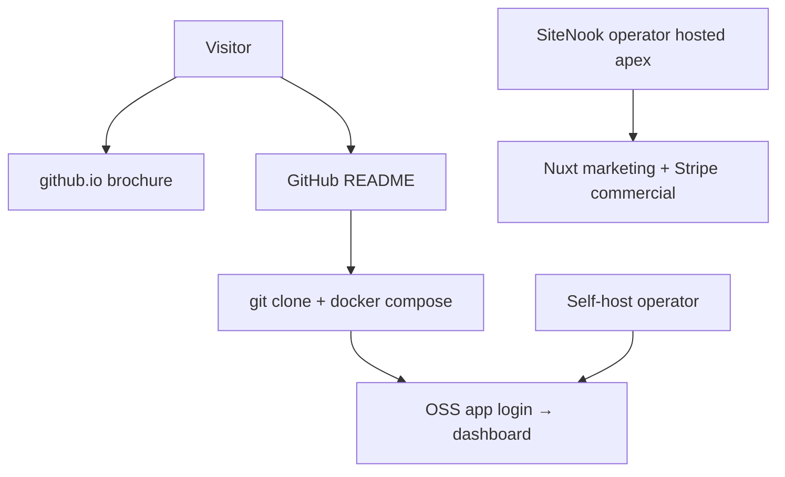

# OSS launch surfaces — what ships where

SiteNook has **three separate surfaces**. Do not mix their content, CTAs, or naming.

| Surface | URL / path | Audience | Ships with `docker compose`? |
|---------|------------|----------|------------------------------|
| **Public brochure** | `https://phatphillips.github.io/SiteNook/` (`website/`) | Strangers discovering the project | **No** |
| **Source + install** | `github.com/phatphillips/SiteNook` README | Developers / operators | N/A (clone instructions) |
| **OSS app** | `http://localhost` after clone | People running SiteNook | **Yes** — login → dashboard only |
| **Paid / hosted apex** | Your domain with marketing + Stripe | Future SaaS customers | **No** for OSS default |

The Nuxt pages under `apps/web/app/components/marketing/` and routes `/`, `/pricing`, `/download`, `/blog`, … are the **paid apex**, not the OSS download experience. Guests on a fresh OSS install must **not** see “Start 30-day Team trial” or Free plan caps messaging.

---

## Launch defaults (locked)

| Flag | OSS default | Meaning |
|------|-------------|---------|
| `SITENOOK_COMMERCIAL` | `0` | Full app, no paywall, no Free caps |
| `NUXT_PUBLIC_MARKETING_SITE` | `false` / off | No Nuxt marketing landing |
| `NUXT_PUBLIC_SELF_SERVICE_SIGNUP` | `false` | No `/start` org wizard |
| `SITENOOK_DEPLOYMENT_MODE` | unset / `cloud` local | Appliance Polar path only if you turn commercial on later |

**Rule:** Marketing apex only when **both** commercial intent and marketing flag are on. In code, if `SITENOOK_COMMERCIAL` is off, the paid Nuxt landing is suppressed even if `NUXT_PUBLIC_MARKETING_SITE=true` (avoids local `.env` accidents).

---

## Include in OSS launch

- Clone + Docker quickstart (README + github.io)
- Dashboard after login: sites, scans, accessibility, QA, SEO, policies, reports
- Unlimited local limits (`SITENOOK_COMMERCIAL=0`)
- MIT licence + [THIRD_PARTY_NOTICES.md](../THIRD_PARTY_NOTICES.md)
- CONTRIBUTING / SECURITY / issue templates
- Optional Typesense / PDF as **optional** compose profiles (do not lead with PDF)
- Screenshots on github.io + README (`website/images/`, `docs/images/`)

## Exclude from OSS launch messaging

| Do not say / show | Why |
|-------------------|-----|
| “Start free trial” / “Team trial” / “See plans” | Paid apex only |
| “1 site / 20 pages” Free caps | Commercial-off is unlimited |
| Polar buy links / licence activation as required | OSS has no paywall |
| “Source is private” / Plex appliance framing | Repo is the product |
| AccessIQ / `AIQ_` naming | Product is **SiteNook** |
| “Enterprise price tag” sales copy on github.io | Keep brochure factual |
| Hosted multi-tenant signup (`/start`) as default | Self-host operators use seed user |
| Shipping the Nuxt marketing site inside the download UX | Brochure is **github.io only** |

---

## Naming and labels

| Use | Avoid |
|-----|--------|
| SiteNook | AccessIQ, accessibility-checker (except legacy paths) |
| Self-hosted / open source | Community Free, Self-host licence (unless commercial on) |
| Install / Get started | Buy, Upgrade, Activate licence (OSS surfaces) |
| Dashboard login | Marketing “Start trial” CTA |
| Optional search / optional PDF | Bundled enterprise search |

Copy tone for github.io + README: plain, operator-friendly, no SaaS funnel. One product name, one install path.

---

## Where content lives

| Content | Location |
|---------|----------|
| Public landing HTML/CSS | [`website/`](../../website/) → GitHub Pages |
| Install docs | Root [README.md](../../README.md) |
| Paid Nuxt landing / pricing / download | `apps/web` marketing components — **hosted apex only** |
| Commercial re-enable | [commercial.md](../commercial.md) |
| Third-party licences | [THIRD_PARTY_NOTICES.md](../../THIRD_PARTY_NOTICES.md) |

---

## Local preview cheat sheet

| You want to see… | Set |
|------------------|-----|
| OSS app (login only when logged out) | `SITENOOK_COMMERCIAL=0`, marketing unset/false |
| Paid Nuxt landing on `:3500` | `SITENOOK_COMMERCIAL=1` **and** `NUXT_PUBLIC_MARKETING_SITE=true` |
| github.io brochure | Edit `website/`, push, Pages via Actions |

After changing flags: recreate/restart the **web** container so Nitro picks up env.
