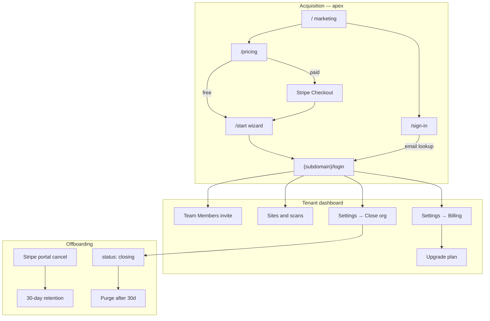

# Platform status (June 2026)

High-level map of what AccessIQ supports today, known gaps, and pre-launch work. For doc index see [README.md](./README.md). Active todos: [CURRENT_TASK.MD](../CURRENT_TASK.MD).

---

## Customer journeys

| Journey | Status | Entry |
|---------|--------|--------|
| Self-service signup (free) | ✅ | `/pricing` → `/start` |
| Paid signup (Starter / Team / Business) | ✅ | `/pricing` → Stripe → `/start` |
| Returning user sign-in | ✅ | `/sign-in` → `{subdomain}/login?email=…` |
| Team invite | ✅ | Settings → Team Members |
| Operator provision | ✅ | `POST /api/provision` |
| Upgrade free → paid in-app | ✅ | Settings → Billing → Upgrade |
| Manage billing (Stripe customer) | ✅ | Settings → Billing → Customer Portal |
| Stripe subscription cancel (churn) | ✅ | Portal → webhook → 30-day retention; org stays `active` |
| Close organization (admin) | ✅ | Settings → General → Danger zone → `status: closing` |
| Dev instant purge | ✅ | `purge-closed-orgs --org-id --force` — [dev-operations.md](./operations/dev-operations.md) |

Legacy alias: `/find-account` redirects to `/sign-in`.

---

## Multi-tenancy and access

- **Org-wide access** — all members see all sites in their org.
- **Roles** — `admin` (read/write) and `viewer` (read-only).
- **Billing contact** — flag on admins; not a separate role.
- **Tenant login** — `{subdomain}.localhost:3000/login` (dev) or `{subdomain}.accessiq.com` (prod).
- **Apex** — marketing, pricing, `/sign-in`, signup wizard; not the day-to-day dashboard.
- **Production apex** — with `NUXT_PUBLIC_TENANT_ONLY=true`, apex dashboard/login blocked; users use `/sign-in` then tenant URL (localhost apex exempt in dev).

Docs: [multi-tenancy.md](./platform/multi-tenancy.md), [users-and-teams.md](./platform/users-and-teams.md), [authentication.md](./platform/authentication.md).

---

## Billing and lifecycle

| Field / feature | Purpose |
|-----------------|--------|
| `organizations.plan` | `free`, `starter`, `team`, `business`, `enterprise` |
| `organizations.status` | `active` or `closing` |
| `stripe_customer_id` / `stripe_subscription_id` | Paid signup or in-dashboard upgrade |
| `subscription_status` | Synced from Stripe webhooks |
| `purge_scheduled_at` | Hard delete eligible after this timestamp |
| `closed_at` / `closed_by` | Admin-initiated closure audit fields |

**Churn vs admin close:** Stripe portal cancel starts **30-day retention** while org remains `active`. Admin **Close organization** sets `status: closing` and blocks login immediately.

Docs: [stripe-setup.md](./platform/stripe-setup.md), [account-closure.md](./platform/account-closure.md), [dev-operations.md](./operations/dev-operations.md).

---

## Product modules (shipped)

| Module | Dashboard | Scanner | Doc |
|--------|-----------|---------|-----|
| Accessibility (axe) | ✅ Overview, Issues, Readability | ✅ Full crawl | [scores.md](./product/scores.md), [accessibility-site-target.md](./product/accessibility-site-target.md) |
| PDF accessibility | ✅ PDFs tab | ✅ VeraPDF | [pdf-accessibility.md](./product/pdf-accessibility.md) |
| Quality Assurance | ✅ Links, spelling, inventory | ✅ | [scans.md](./product/scans.md) |
| SEO | ✅ Overview, Technical, Content, SERP preview | ✅ Site + page pass | [seo.md](./product/seo.md) |
| Global search | ✅ `/search` | ✅ Typesense indexer | [global-search.md](./product/global-search.md) |
| Scans & scheduling | ✅ `/scans` | ✅ Queue + scheduler | [scans.md](./product/scans.md) |
| Policies | ✅ `/policies` | ✅ Content match | — |
| Billing & plans | ✅ Settings → Billing | — | [stripe-setup.md](./platform/stripe-setup.md) |

---

## Known gaps and future work

Use this section when prioritizing features or onboarding agents. Items marked **stub** have UI/routes but no real implementation yet.

### Platform and auth

| Gap | Priority | Notes |
|-----|----------|-------|
| OAuth / SAML / SSO | High for enterprise | Email/password only today |
| Per-site access control | Low | `site_access` collection exists but rules are org-wide |
| MFA | — | Not implemented |

### Product — accessibility & QA

| Gap | Priority | Notes |
|-----|----------|-------|
| Issue dismiss / fixed workflow | Removed | Open issues only; resolved routes redirect to issues |
| Jira / ticket integration | **stub** | Settings → Integrations placeholder |
| Scan completion email | Medium | `notifyEmail` stored in site settings; delivery not wired |
| Manual WCAG test guides | — | No assisted manual testing module |
| Developer/designer/editor issue roles | — | Not implemented |

### Product — SEO

| Gap | Priority | Notes |
|-----|----------|-------|
| Google Search Console | Future | Listed in CURRENT_TASK.MD |
| SEO CSV export | Future | — |
| SEO policy category | Future | Policies module has no SEO type |
| Resolved SEO issues UI | — | Intentionally omitted (open only) |

### Product — reporting & export

| Gap | Priority | Notes |
|-----|----------|-------|
| Reports page | **stub** | Sidebar links to `/reports` — no page implemented |
| CSV / PDF export (issues) | — | No bulk export |
| Scheduled email reports | — | — |

### Product — integrations

| Gap | Priority | Notes |
|-----|----------|-------|
| Webhooks | **stub** | Integrations page placeholder |
| Slack | **stub** | — |
| CMS plugins (Drupal, AEM) | — | Enterprise sales item |

### Infrastructure & ops

| Gap | Priority | Notes |
|-----|----------|-------|
| Production DNS + TLS (E4) | Pre-launch | [go-live.md](./operations/go-live.md) |
| Production SMTP inbox verify (E2) | Pre-launch | [onboarding.md](./platform/onboarding.md) |
| Stripe live keys + webhook | Pre-launch | [stripe-setup.md](./platform/stripe-setup.md) |
| Viewer read-only E2E | Pre-launch | [go-live.md](./operations/go-live.md) §8 |
| Typesense GPL review | Legal | Required for closed-source appliance distribution |
| PocketBase horizontal scale | — | Single SQLite writer; Litestream for DR only |

### Enterprise self-hosted

| Gap | Priority | Notes |
|-----|----------|-------|
| Licence validation API | ✅ Implemented | [licence-api.md](./platform/licence-api.md) |
| Air-gapped heartbeat | Partial | Signed offline token; weekly heartbeat documented |
| Private image distribution | Sales | Not in public repo workflow |

---

## Phases completed (platform)

| Phase | Summary |
|-------|---------|
| **A–D** | Multi-tenant schema, subdomain routing, provisioning, docs |
| **Team roles** | `admin`/`viewer`, billing contact, activity log |
| **E3** | Tenant-only apex (`NUXT_PUBLIC_TENANT_ONLY`) |
| **F–G** | Self-service `/start`, marketing, Stripe checkout |
| **H** | Single-link invite / account setup emails |
| **I** | Org closure, Customer Portal, webhooks, 30-day purge |
| **J** | Dev purge ergonomics, in-dashboard upgrade, `/sign-in` hub |
| **Product** | SEO module, Typesense search, PDF validation, readability |

**Manual ops still open:** see [go-live.md](./operations/go-live.md) (DNS, SMTP, Stripe live, E2E hardening).

---

## Known limitations (not bugs)

1. **30-day retention** — production by design; dev purge uses `--force` (see [dev-operations.md](./operations/dev-operations.md)).
2. **Enterprise plan** — sales-led only; no Stripe SKU or in-app upgrade path.
3. **Closed org with empty `stripe_*`** — expected for free/dev-bypass signups.
4. **Stripe return on localhost subdomains** — billing portal uses a `localhost` bridge redirect in dev.
5. **Legacy plan alias** — `NUXT_STRIPE_STANDARD_PRICE_ID` maps to Team tier for old installs.

---

## Pre-launch checklist (not blocking dev)

| Item | Doc |
|------|-----|
| Viewer read-only E2E | [go-live.md](./operations/go-live.md) §8 |
| Second-tenant isolation smoke | [go-live.md](./operations/go-live.md) §8 |
| Paid signup + portal cancel + upgrade flows | [stripe-setup.md](./platform/stripe-setup.md), [account-closure.md](./platform/account-closure.md) |
| Scanner integration tests | `cd apps/scanner && npm run test:integration` |
