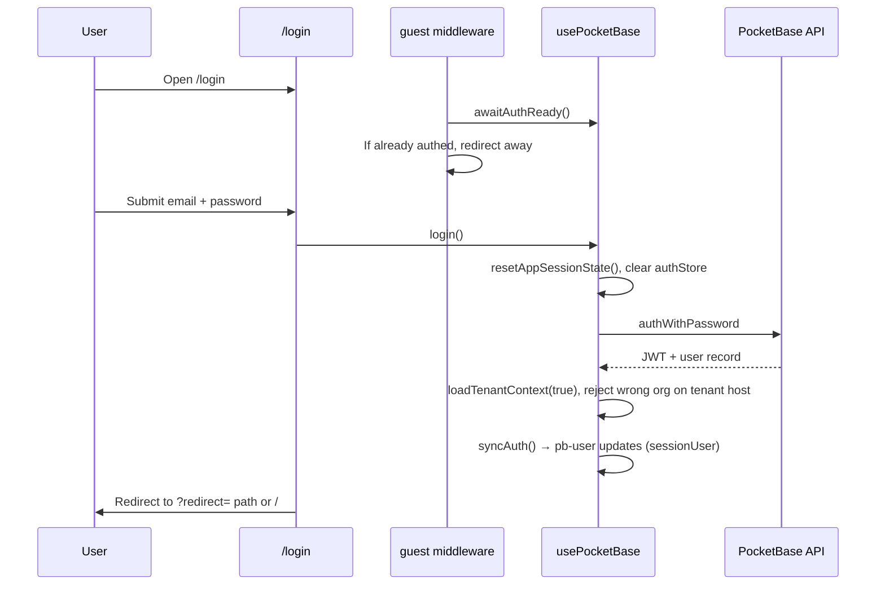
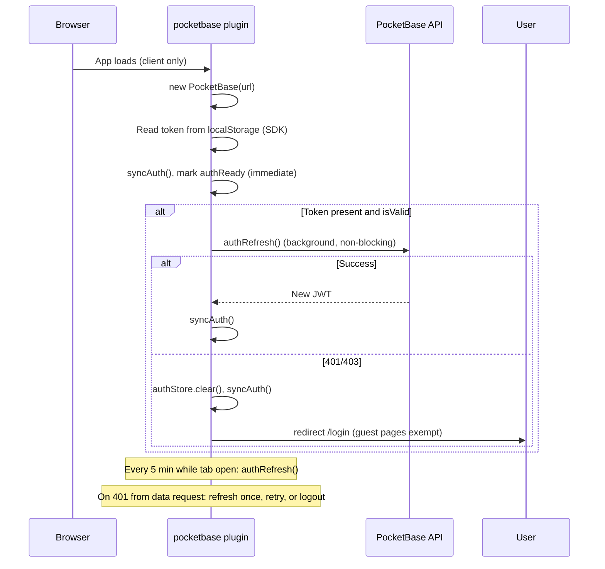
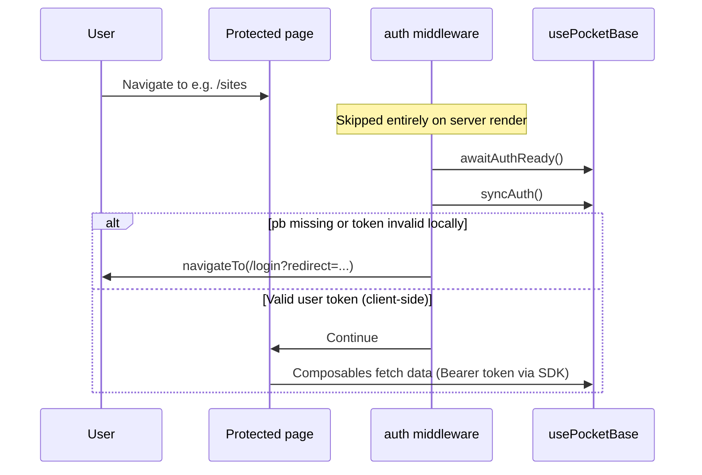
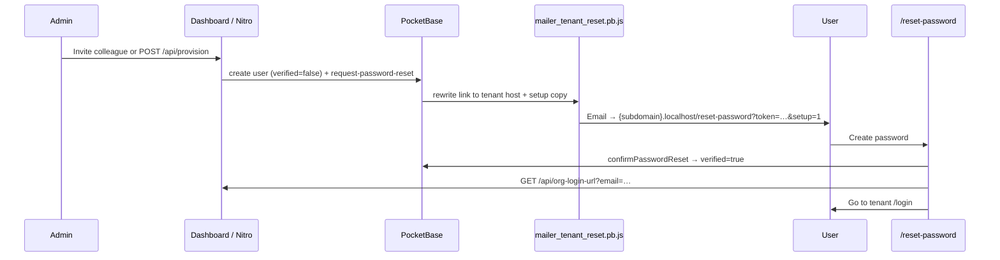

# Authentication in SiteNook

This document describes how user sign-in works in the SiteNook dashboard. It covers the web app only. The scanner worker uses a separate admin credential flow (documented briefly at the end).

### Implementation status (2026-06-13)

| Track | Status |
|-------|--------|
| **Phase A** — org data model + API rules | ✅ Complete |
| **Access hardening** — security hook, org-wide access, admin/viewer roles, billing contact | ✅ Complete |
| **Phase B** — subdomain tenant routing | ✅ Complete — see [multi-tenancy.md](./multi-tenancy.md) |
| **Phase C** — invite-only provisioning (lock `/signup`, provisioning API) | ✅ Verified — see [onboarding.md](./onboarding.md) |
| **Phase D** — doc polish + auth hardening follow-ups | ✅ Complete |
| **Team roles simplification** | ✅ Complete — `admin`/`viewer`, `is_billing_contact`; see [users-and-teams.md](./users-and-teams.md) |

Task tracking: [CURRENT_TASK.MD](../CURRENT_TASK.MD).

---

## 1. Overview

SiteNook uses **PocketBase** as its identity provider. There is no custom auth server, no OAuth providers, and no Nuxt server-side session. The browser talks directly to PocketBase over HTTP, and the PocketBase JavaScript SDK manages the login token.

**Multi-tenancy:** Data is partitioned by **organization**. Each user belongs to one organization; sites and all scan/issue data are scoped to that organization via PocketBase API rules. **Read** access is org-wide (any member sees all sites/data in their org). **Write** access requires org **`admin`** (`viewer` is read-only). The legacy `site_access` join collection remains in the schema but is no longer used in API rules.

**Subdomain routing (Phase B):** The dashboard resolves the tenant from the request host (`agency.sitenook.com` → `organizations.subdomain`). See [multi-tenancy.md](./multi-tenancy.md). Apex hosts (`localhost`, `sitenook.com`) allow any org member to log in; tenant hosts restrict login to users in that org. Unknown subdomains show `/account-not-found`.

**Phase C:** Public `users` creation is blocked at the API (`createRule` requires org admin). New orgs are provisioned via `POST /api/provision` (Nitro + API key). Org admins invite colleagues at `/settings/users` with account setup email. `/signup` is an invite-only contact page.

### What is supported today

| Flow | Supported? | How it works |
|------|------------|--------------|
| **Sign up** | Self-service or invite | When `NUXT_PUBLIC_SELF_SERVICE_SIGNUP=true`, apex `/pricing` → `/start`. Otherwise operator `POST /api/provision`. Colleagues: Settings → Team Members. See [onboarding.md](./onboarding.md). |
| **Subdomain tenants** | Yes (Phase B + E3) | `useTenantOrg()` + `/api/org-context`; tenant hosts gate login by org; prod apex uses `NUXT_PUBLIC_TENANT_ONLY` → `/sign-in`. |
| **Login** | Yes | Email + password on `/login` via PocketBase `authWithPassword`. |
| **Logout** | Yes | Clears the local PocketBase auth store and redirects to `/login`. |
| **Session restore / token refresh** | Yes | On each full page load, the app **trusts a valid persisted token immediately** (no logged-out flash), then refreshes it in the background. While the tab stays open, a **5-minute background refresh** runs, and **401 responses trigger refresh-and-retry** (see § Token lifecycle). |
| **Account switching** | Yes | Logout/login clears shared composable caches (`resetAppSessionState`) and syncs the signed-in user into reactive Vue state so the sidebar and permissions update without a hard refresh. |
| **Password reset / invite email** | Yes | `/forgot-password` and team invites call `requestPasswordReset`. Links use the recipient’s **tenant host** (`mailer_tenant_reset.pb.js`). Invites add `?setup=1` and account-setup copy when `users.verified` is false. `/reset-password` confirms the token and resolves tenant login via `GET /api/org-login-url`. Requires PocketBase **SMTP**. |
| **Org provisioning** | Yes (operator) | `POST /api/provision` with `NUXT_PROVISION_API_KEY` creates org + first admin (billing contact) + account-setup email. See [onboarding.md](./onboarding.md). |
| **Email verification** | Yes (via set-password link) | New provisioned and invited users are created with `verified: false`. Completing `/reset-password` (`confirmPasswordReset`) sets `verified: true` — the reset token proves inbox access; no separate verify page. Seed user remains `verified: true` at install. |
| **Third-party login** | No | No Google, GitHub, SAML, etc. |

### High-level flow

1. User opens the dashboard. A Nuxt plugin creates a PocketBase client in the browser.
2. If a token was saved from a previous visit, the plugin syncs it into Vue state immediately and marks auth ready; a background `authRefresh()` runs without blocking the UI.
3. Route middleware checks whether the user is signed in before showing protected pages.
4. All data reads and writes go to PocketBase with the JWT attached automatically by the SDK.
5. PocketBase collection rules reject requests that do not carry a valid user token.
6. If a data request returns **401**, the client refreshes the token once and retries; if refresh fails, the session is cleared and the user is sent to `/login`.

Protected pages do **not** rely on server-side auth checks. Middleware runs in the browser only, so protection happens after the page shell loads on the client.

---

## 2. Tech stack

### Libraries and services

| Component | Version (as pinned in repo) | Role |
|-----------|----------------------------|------|
| **PocketBase server** | `0.25.8` (`services/pocketbase/Dockerfile`) | Issues JWTs, stores users, enforces API rules |
| **pocketbase** (JS SDK) | `^0.25.2` (`apps/web/package.json`) | Client auth, token storage, API calls |
| **Nuxt** | `^4.4.6` | App framework, route middleware, plugins, runtime config |
| **VueUse** (`createSharedComposable`) | `^14.3.0` | Single shared `usePocketBase()` instance across the app |
| **Nginx** | Docker image in `nginx/` | Proxies `/api/` and `/_/` to PocketBase in production |

There are **no** third-party auth providers, no NextAuth/Auth.js, and no custom JWT library on the frontend.

### PocketBase `users` collection

PocketBase ships a built-in auth collection (`users` / `_pb_users_auth_`). Bootstrap and boot-time patches configure it:

- **Email + password** auth enabled (`allowEmailAuth: true`)
- **Minimum password length**: 8 characters (enforced in PocketBase and again in the signup form)
- **`organization` relation** (required after backfill) — links the user to an `organizations` record
- **User creation** via API: org **`admin`** only (`createRule` requires `organization = @request.auth.organization`); unauthenticated clients cannot self-register
- **Org-scoped visibility**: `listRule` / `viewRule` are `organization = @request.auth.organization` (users can see colleagues in the same org)
- **`updateRule`**: self-update, or org **`admin`** may update users in the same org
- **`deleteRule`**: org **`admin`** may delete teammates in the same org, but not themselves (hook enforces last-admin / last-billing-contact rules)
- **`role` field**: `admin` or `viewer` — enforced in PocketBase rules, security hooks, and the dashboard UI (`canWriteOrg`, team management)
- **`is_billing_contact`**: boolean on admin users; at least one per org required (see [users-and-teams.md](./users-and-teams.md))
- **Login alert emails** enabled for new devices (`authAlert.enabled: true`). Known devices are stored in PocketBase `_authOrigins` (IP + user-agent fingerprint). Boot patches set `meta.appName` to SiteNook and trust nginx `X-Forwarded-For` / `X-Real-IP` so container restarts do not look like a new location. The seed app-user password is only rewritten when env credentials are out of sync (re-hashing clears known devices).

Default install also seeds an app user from `APP_USER_EMAIL` / `APP_USER_PASSWORD` env vars (see `services/pocketbase/seed.sh`). Idempotent updates run on every boot via `patch-users.sh`.

### Where auth state lives

| Layer | What is stored | Where |
|-------|----------------|-------|
| **PocketBase SDK `authStore`** | JWT token + user record | Browser **localStorage** (default PocketBase SDK behaviour; key is tied to the PocketBase base URL) |
| **Nuxt `useState`** | `pb-user`, `pb-authenticated`, `pb-auth-ready` | In-memory per browser tab/session (hydrated from `authStore` via `syncPbAuthState` on every auth change) |
| **Cookies** | — | Not used for app user auth |
| **Nuxt server / Nitro** | — | No server-side session; `$pb` is `null` on the server |

### How the app reads auth state

- **`usePocketBase()`** (`app/composables/usePocketBase.ts`) — shared composable; exposes `login`, `signup`, `logout`, `requestPasswordReset`, `confirmPasswordReset`, `sessionUser`, `isAuthenticated`, `requireUser()`, `awaitAuthReady()`. **`sessionUser` reads the reactive `pb-user` ref** (not `pb.authStore` directly — the SDK store is not Vue-reactive and would cache the first signed-in user until a full reload).
- **`app/plugins/pocketbase.ts`** — creates the client, wires `authStore.onChange`, syncs auth immediately on load, runs background token refresh, attaches 401 retry interceptor, starts periodic refresh, exposes `$pb` and `$authReady`.
- **`app/utils/pbAuth.ts`** — helpers to sync SDK state into Vue refs, guest-route allowlist, and safe post-login redirect paths.
- **`app/utils/sessionReset.ts`** — clears shared composable caches (`useSites`, `useScans`, `useTeamMembers`, filters) on login/logout so switching accounts does not leak the previous user's data or display name.
- **`app/utils/orgAccess.ts`** — `isOrgAdmin`, `canWriteOrg`, `isBillingContact`, `canChangeRole`, `canRemoveMember`, `canToggleBillingContact`, and related org-role helpers used across the dashboard.
- **`app/utils/pbAuthInterceptors.ts`** — 401 refresh-and-retry wrapper, periodic refresh interval, shared in-flight refresh deduplication.
- **`app/middleware/auth.ts`** — blocks unauthenticated users from protected routes (client only).
- **`app/middleware/guest.ts`** — redirects signed-in users away from `/login`, `/signup`, `/forgot-password`, and `/reset-password`.
- **`app/plugins/validatePublicConfig.ts`** — in **production** client builds, throws if `NUXT_PUBLIC_POCKETBASE_URL` is missing.
- **`app/plugins/tenant.ts`** + **`useTenantOrg()`** — loads `/api/org-context` (host → organization) on app init.
- **`app/middleware/tenant.global.ts`** — unknown subdomain → `/account-not-found`; wrong-org session → login.

There is no Pinia auth store. Feature composables (`useSites`, `useScans`, etc.) call `requireUser()` or `awaitAuthReady()` before PocketBase requests.

### Runtime configuration

| Variable | Purpose | Default if unset |
|----------|---------|------------------|
| `NUXT_PUBLIC_POCKETBASE_URL` | PocketBase API base URL for the browser | `http://localhost:8090` (dev only); **required in production** (validated at startup) |
| `NUXT_PUBLIC_APP_URL` | Public app URL | `http://localhost:3000` |
| `NUXT_PUBLIC_APP_DOMAIN` | Base domain for tenant subdomain parsing | `localhost` (dev) / `sitenook.com` (prod) |
| `NUXT_POCKETBASE_URL` | Server-side PocketBase URL (Nitro only) | `http://pocketbase:8090` in Docker |
| `NUXT_PB_ADMIN_EMAIL` / `NUXT_PB_ADMIN_PASSWORD` | Superuser creds for Nitro admin routes | Same as `PB_ADMIN_*` |
| `NUXT_PROVISION_API_KEY` | Shared secret for `POST /api/provision` (server only) | Unset = provisioning API returns 503 |
| `NUXT_PUBLIC_SUPPORT_EMAIL` | Contact on `/signup` invite-only page | Placeholder in `.env.example` |
| `NUXT_PUBLIC_TENANT_ONLY` | Prod: apex host → `/sign-in` (localhost apex exempt) | `false` |
| `APP_DASHBOARD_URL` | PocketBase container: base URL in password-reset email template | `http://localhost:3000` (dev) |
| `APP_PUBLIC_DOMAIN` | PocketBase container: tenant subdomain suffix for mail hook | `localhost` / `sitenook.com` |

The browser does **not** use admin credentials. The **Nuxt server** uses `NUXT_PB_ADMIN_*` for `/api/org-context`, `/api/org-login-url`, and `/api/provision`. PocketBase bootstrap and the scanner use `PB_ADMIN_*` separately.

### Organizations and `site_access`

| Collection | Purpose | Key fields |
|------------|---------|------------|
| **`organizations`** | Tenant boundary | `name`, `subdomain` (unique slug), optional `plan` (`free` / `starter` / `team` / `business` / `enterprise`) |
| **`site_access`** | Legacy per-site join (deprecated) | `user`, `site`, `role` — **no longer used in API rules**; org `users.role` alone controls read vs write |

Migration `1730000020_multi_tenant.js` creates these collections, adds `organization` to `users` and `sites`, updates API rules, and backfills a **Default Organization** (`subdomain: default`). `patch-multi-tenant.sh` re-runs backfill idempotently on every boot.

### API authorization model

After login, every PocketBase request includes `Authorization: <token>` (handled by the SDK). Collection rules in `patch-rules.sh` (re-applied every boot) scope data by organization and org role:

- **Read** (list/view): `organization = @request.auth.organization` on `sites`, or the equivalent via `site.organization` / `scan.site.organization` on child collections. Any org member (`admin`, `viewer`) can read all org data.
- **Write** (create/update/delete): same org check **and** `@request.auth.role` is **`admin`**. Viewers are read-only at the API layer.
- **`users`**: same-organization list/view; self-update for profile fields; org **`admin`** update for teammates; org **`admin`** delete for teammates (hook enforces last-admin / last-billing-contact). The `users_security.pb.js` hook blocks self-escalation on `role` / `organization` (see §6).

The dashboard hides write controls (Add Site, Scan Now, site settings edit, etc.) when `canWriteOrg(sessionUser)` is false — matching the API rules. Team management at `/settings/users` is available to org **`admin`** (add member, change role, billing contact toggle, remove member, activity log).

On login/logout, `resetAppSessionState()` clears shared composable caches so switching accounts does not show the previous user’s data or sidebar name.

The scanner worker uses **superuser** credentials and bypasses these rules.

The Nitro route `server/api/sitemap-preview.get.ts` validates the caller's token server-side via `requirePbUser()` (used by `ScanConfigModal.vue`).

---

## 3. Token lifecycle

### Startup refresh

On each full page load (client only), the PocketBase plugin:

1. Reads any saved token from localStorage (SDK default).
2. Calls `syncAuth()` so `pb-user` / `pb-authenticated` reflect the persisted session immediately.
3. Marks `authReady` so middleware and composables can proceed **without waiting** for a network round-trip.
4. If `authStore.isValid`, runs `authRefresh()` **in the background**; on 401/403, clears the auth store and re-syncs.

This avoids a multi-second "logged out" flash on hard refresh when a valid token is already in localStorage. If background refresh clears an invalid or expired session (`401`/`403`), the client redirects to `/login` immediately (unless already on a guest auth page).

### Login / logout and account switching

On **login**, `usePocketBase().login()`:

1. Calls `resetAppSessionState()` and clears `authStore`.
2. Authenticates with `authWithPassword`.
3. Calls `syncAuth()` so `sessionUser` (via `pb-user`) updates reactively.

On **logout**, `logout()` resets session state, clears `authStore`, syncs Vue refs, and navigates to `/login`.

`authStore.onChange` also calls `syncAuth()` on every token change, keeping `sessionUser` in sync for the lifetime of the tab.

### 401 refresh-and-retry (in-session)

All PocketBase SDK requests go through a wrapped `pb.send()`:

1. Request fails with **401** (and is not itself an auth endpoint).
2. A single shared `authRefresh()` runs (concurrent 401s deduplicated).
3. On success, the original request is retried once.
4. On failure, `authStore` is cleared and the user is redirected to `/login?redirect=<current path>` (unless already on a guest auth page).

Auth-related paths (`auth-with-password`, `auth-refresh`, password-reset endpoints, etc.) are excluded from retry to avoid loops.

### Periodic background refresh

Every **5 minutes** (`PERIODIC_AUTH_REFRESH_MS`), while the tab is open and `authStore.isValid`, the client calls `authRefresh()` proactively. This reduces mid-session expiry for idle tabs. Failed periodic refresh clears the store on 401/403 but does not redirect until a subsequent 401 on a data request or navigation triggers `handleSessionExpired`.

### Invalid or tampered tokens

**Route guards are client-side only.** Middleware checks `pb.authStore.isValid` and that the stored record is a `users` collection record. The SDK's `isValid` reflects **local** state (token and record present, and JWT not past its client-parsed expiry) — it does **not** contact PocketBase on every navigation.

If you manually corrupt the JWT in localStorage (e.g. replace `token` with random text while keeping `record`), typical behaviour is:

| Step | What happens |
|------|----------------|
| **Reload page** | Startup `authRefresh()` fails → store cleared → middleware should send you to `/login` when loading a protected route. |
| **Stay on page without reload** | In-memory token may still be the old valid JWT until reload; behaviour is undefined for DevTools edits. |
| **Navigate with corrupt token loaded** | Middleware may still treat you as signed-in briefly; PocketBase data requests return **401** → interceptor tries refresh → refresh fails → **redirect to `/login`**. |
| **Empty dashboard, no redirect** | If composables swallow errors or no PocketBase request fires, you can see an empty UI while the shell still renders. This is **not ideal** and is a known UX gap; the intended recovery path is the 401 interceptor on the first failing API call. |

**Bottom line:** PocketBase collection rules still block bad tokens from reading data. If startup `authRefresh()` clears an invalid session (`401`/`403`), the pocketbase plugin redirects to `/login` immediately (unless already on a guest auth page). Remaining edge cases (empty shell before any API call) are rare after this change.

---

## 4. Flow diagrams

### Login



### Token refresh (app startup + background)



### Protected route access



### Password reset and team invite

Provisioning and team invites use the same PocketBase **password-reset** pipeline. See [onboarding.md](./onboarding.md) for the full sequence. Summary:

- New users (provision + team invite) are created with **`verified: false`**.
- The set-password email uses **account setup** copy and appends **`?setup=1`** when the user is unverified (`mailer_tenant_reset.pb.js`).
- **`confirmPasswordReset`** on `/reset-password` sets **`verified: true`** (PocketBase 0.25.x).
- Forgot-password for existing users keeps **reset password** copy (no `setup=1`).



---

## 5. Key files

### Web app (`apps/web/`)

| File | Description |
|------|-------------|
| `app/plugins/pocketbase.ts` | Browser PocketBase client, startup refresh, 401 interceptor, periodic refresh, `authStore.onChange` sync |
| `app/plugins/validatePublicConfig.ts` | Production guard for `NUXT_PUBLIC_POCKETBASE_URL` |
| `app/composables/usePocketBase.ts` | Shared auth API: login, signup, logout, password reset, reactive `sessionUser`, `requireUser`, `awaitAuthReady` |
| `app/utils/pbAuth.ts` | Sync SDK → Vue state, guest paths, safe post-login redirect paths |
| `app/utils/pbAuthInterceptors.ts` | 401 retry wrapper, periodic refresh, refresh helper |
| `app/utils/sessionReset.ts` | Clear shared composable state on login/logout / account switch |
| `app/utils/orgAccess.ts` | Org roles (`admin`, `viewer`), `isBillingContact`, `canWriteOrg`, team-management helpers |
| `app/middleware/auth.ts` | Client route guard; redirects to `/login` with `redirect` query |
| `app/middleware/guest.ts` | Keeps signed-in users off login/signup/reset pages |
| `app/pages/login.vue` | Login form; shows tenant org name on subdomain hosts |
| `app/pages/account-not-found.vue` | Unknown tenant subdomain |
| `server/api/org-context.get.ts` | Resolve host → organization (superuser lookup) |
| `app/utils/subdomain.ts` | Host header → tenant slug parsing |
| `app/pages/signup.vue` | Invite-only contact page (no registration) |
| `app/pages/forgot-password.vue` | Request password reset email |
| `app/pages/reset-password.vue` | Set new password; tenant login URL via `/api/org-login-url` |
| `app/utils/resetToken.ts` | Decode email from password-reset JWT (client) |
| `app/utils/pbClientError.ts` | PocketBase SDK error messages for team invite UI |
| `server/api/provision.post.ts` | Operator provisioning (API key) |
| `server/api/org-login-url.get.ts` | Resolve tenant login URL from user email |
| `server/utils/provisioning.ts` | Org provisioning validation and helpers |
| `server/utils/requireProvisionKey.ts` | Guards `POST /api/provision` |
| `app/components/UserMenu.vue` | Shows current user name; logout action |
| `app/components/settings/TeamMembersTable.vue` | Team table: role dropdown, remove member (gated by `isOrgAdmin`) |
| `app/pages/settings/users.vue` | Team members: add, change role, billing contact, activity log, remove |
| `app/composables/useTeamMembers.ts` | Fetch org users; create, update, remove member; activity log (admin only for writes) |
| `server/utils/requirePbUser.ts` | Validates `Authorization` header for Nitro routes |
| `server/api/sitemap-preview.get.ts` | Sitemap preview (requires authenticated user) |
| `app/types/pocketbase.d.ts` | TypeScript declarations for `$pb` and `$authReady` on `NuxtApp` |
| `nuxt.config.ts` | `runtimeConfig.public.pocketbaseUrl` and `appUrl` |
| `tests/e2e/auth.spec.ts` | Playwright smoke tests for login, forgot password, post-login redirect |
| `tests/unit/utils/pbAuth.test.ts` | Unit tests for redirect paths and `syncPbAuthState` |
| `tests/unit/utils/orgAccess.test.ts` | Unit tests for `isOrgAdmin`, `canWriteOrg`, billing contact guards |
| `apps/scanner/tests/integration/usersHooks.test.ts` | Integration tests for `users_security` hooks |
| `apps/scanner/tests/integration/orgRoleAccessRules.test.ts` | Integration tests for org-wide read / admin write rules |
| `tests/unit/utils/pbAuthInterceptors.test.ts` | Unit tests for 401 retry behaviour |
| `tests/unit/utils/resetToken.test.ts` | Password-reset JWT email decode |
| `tests/unit/server/requirePbUser.test.ts` | Nitro auth guard (used by `sitemap-preview`) |
| `tests/unit/server/sitemapPreview.test.ts` | `sitemap-preview` requires authenticated user |
| `tests/unit/server/provisioning.test.ts` | Provisioning validation helpers |

### PocketBase / infrastructure (`services/pocketbase/`, `nginx/`)

| File | Description |
|------|-------------|
| `services/pocketbase/Dockerfile` | PocketBase `0.25.8` image |
| `services/pocketbase/bootstrap.sh` | One-time setup: org-admin user create rules, `role` field, email auth options |
| `services/pocketbase/patch-app-settings.sh` | Sets `meta.appName` to SiteNook and trusted proxy IP headers |
| `services/pocketbase/patch-users.sh` | Idempotent users rules, auth alert template, reset-password URL, seed user sync (password only when out of sync) |
| `services/pocketbase/pb_hooks/users_security.pb.js` | Users security hook entry points |
| `services/pocketbase/pb_hooks/users_security_lib.js` | Shared hook logic (required for isolated handler scopes) |
| `services/pocketbase/pb_hooks/mailer_tenant_reset.pb.js` | Rewrites password-reset email links to tenant subdomain |
| `services/pocketbase/pb_migrations/1730000026_team_roles_billing_contact.js` | Role simplification (`admin`/`viewer`), `is_billing_contact`, `team_activity_log` |
| `services/pocketbase/seed.sh` | Creates default app user from env; sets `verified: true` |
| `services/pocketbase/pb_migrations/1730000020_multi_tenant.js` | Organizations, org fields, `site_access`, org-scoped rules, backfill |
| `services/pocketbase/pb_migrations/1730000021_site_access_write_rules.js` | Viewer read-only write rules on sites and child collections |
| `services/pocketbase/patch-multi-tenant.sh` | Idempotent default-org backfill on every boot |
| `services/pocketbase/patch-rules.sh` | Org-wide read; `admin` write; `site_access` deprecated in comments |
| `nginx/nginx.conf` | Proxies `/api/` → PocketBase for browser SDK |
| `.env.example` | Documents `PB_ADMIN_*`, `APP_USER_*`, `NUXT_PUBLIC_POCKETBASE_URL` |

### Related (not end-user auth)

| File | Description |
|------|-------------|
| `apps/scanner/src/db/pocketbaseClient.ts` | Scanner authenticates as PocketBase **superuser/admin** via env credentials |

### Pages using `auth` middleware

All main dashboard routes, including `/`, `/sites`, `/scans`, `/policies`, `/settings`, and per-site accessibility/QA pages. Login, signup, forgot-password, and reset-password use `guest` middleware instead.

---

## 6. Security considerations

### Token storage: XSS vs CSRF

- **Storage**: The PocketBase SDK keeps the JWT in **localStorage**. Any XSS vulnerability in the dashboard could read that token and impersonate the user until the token expires.
- **CSRF**: API calls use the `Authorization` header, not cookies, so classic cross-site request forgery against PocketBase APIs is less likely. The token is still visible to same-origin JavaScript.
- **No HttpOnly cookies**: There is no cookie-based session that JavaScript cannot read.

### Client-only route protection

`auth` middleware returns immediately on the server (`import.meta.server`). Nuxt may render page shells before the client redirect runs. **Do not assume** protected data is hidden from unauthenticated visitors at the HTML/SSR layer — rely on PocketBase API rules for real enforcement.

Tampering with localStorage (see § Invalid or tampered tokens) can produce a signed-in shell with no data until the 401 handler runs.

### Public signup

`users.createRule` requires an authenticated org **`admin`** creating a user in their own organization (`patch-users.sh` on every boot). Unauthenticated `POST /api/collections/users/records` returns 403. Platform operators provision new orgs via `POST /api/provision` (see [onboarding.md](./onboarding.md)).

### User record visibility

Authenticated users can **list and view all users in their organization** (`organization = @request.auth.organization`). They can update their own profile; org **`admin`** can manage teammates.

### Users collection security hook

The `users` collection `updateRule` allows self-update (`id = @request.auth.id`) so members can change their own name and password. That rule alone would also permit patching `role` or `organization` on your own record.

PocketBase hooks (`services/pocketbase/pb_hooks/users_security.pb.js` + `users_security_lib.js`, copied into the Docker image on build) enforce additional rules on **create**, **update**, and **delete** requests:

| Operation | Non-superuser behaviour |
|-----------|-------------------------|
| **Update `role`** | Admin only; must be `admin` or `viewer`; blocks last-admin demotion; blocks self-escalation |
| **Update `organization`** | Rejected when merged record differs from original |
| **Update `is_billing_contact`** | Admin only; viewers cannot be billing contacts; blocks clearing last billing contact |
| **Demote admin → viewer** | Auto-clears `is_billing_contact` when allowed |
| **Delete user** | Admin only; cannot delete self, last admin, or last billing contact |
| **Create user** | Admin only; role must be `admin` or `viewer` |
| **Activity log** | Writes `team_activity_log` entries on member add/remove/role/billing changes |
| **Superuser** | Bypasses hook checks (seed scripts, PocketBase admin UI, integration test setup) |

**Implementation note:** Shared logic lives in `users_security_lib.js` and is loaded via `require()` inside each handler — PocketBase hook handlers run in isolated scopes and cannot call top-level helper functions directly.

Rebuild PocketBase after hook changes:

```bash
docker compose build pocketbase && docker compose up -d --force-recreate pocketbase
# integration tests:
docker compose --profile test build pocketbase-test && docker compose --profile test up -d --force-recreate pocketbase-test
cd apps/scanner && npm run test:integration
```

Team management UI gates admin actions with `isOrgAdmin(sessionUser)`. Remove is hidden when `canRemoveMember` returns false (last admin / last billing contact). Billing contact toggle uses `canToggleBillingContact`. See [users-and-teams.md](./users-and-teams.md).

### Role field enforcement (data collections)

`admin` and `viewer` are the only valid org roles. PocketBase rules and the dashboard UI treat **viewer** as read-only; **admin** may write. Legacy `owner` / `analyst` values are migrated on boot.

### Password reset and SMTP

- Password reset UI is implemented; **emails require SMTP** configured in PocketBase (`/_/` → Settings → Mail).
- For production deliverability (SPF/DKIM, Resend/SendGrid), see [onboarding.md](./onboarding.md) § Email deliverability.
- `/forgot-password` surfaces a friendly error when SMTP is not configured.
- New self-registered users are not prompted to verify email in the UI.

### Environment and secrets

| Item | Risk |
|------|------|
| `.env.example` defaults | `changeme_strong_password_here` / `changeme_app_password` — must be changed in production |
| `NUXT_PUBLIC_POCKETBASE_URL` | Validated in production client startup; dev still falls back to `http://localhost:8090` |
| Admin credentials in scanner | `POCKETBASE_ADMIN_EMAIL` / `POCKETBASE_ADMIN_PASSWORD` are required and powerful; separate from app users |
| `sitemap-preview` API | Now requires a valid user `Authorization` header; still fetches arbitrary URLs server-side (SSRF risk if exposed publicly) |

### Redirect hardening

Post-login redirects use `resolveLoginRedirectPath()` to allow only same-app paths (must start with `/`, block `//` open redirects). This is tested in `pbAuth.test.ts`.

### PocketBase as single point of trust

All authorization truth lives in PocketBase rules and JWT validation. Compromise or misconfiguration of PocketBase undermines the entire app.

---

## 7. Potential bottlenecks and risks

### Performance

| Issue | Impact |
|-------|--------|
| **Background auth refresh on every full load** | `authReady` resolves immediately from localStorage; a background `authRefresh()` may still add latency to the first API call if the token is expired server-side. |
| **`auth` middleware on many pages** | Each navigation runs `awaitAuthReady()` + `syncAuth()`. Cheap after first ready, but first paint can feel slow if PocketBase is distant or slow. |
| **No auth caching layer** | Every composable hits PocketBase directly; no edge or server cache of user identity. |
| **PocketBase single instance** | All users and the scanner share one PocketBase process; auth latency scales with PB load. |

### Reliability

| Issue | Impact |
|-------|--------|
| **Periodic refresh every 5 min** | Reduces stale-token surprises on idle tabs; still depends on PocketBase availability. |
| **401 retry** | Most expired-token cases recover transparently; failed refresh forces re-login. |
| **Background refresh failures** | Slow PocketBase can delay token renewal; `authReady` no longer blocks on refresh, but the first data fetch may 401 and trigger the interceptor. |
| **PocketBase down** | Login, refresh, and all data fail. There is no offline or degraded mode. |
| **Startup refresh failure** | Clears session but may not redirect until middleware runs — brief empty UI possible. |

### User experience

| Issue | Impact |
|-------|--------|
| **Flash before redirect** | Client-only middleware may briefly show layout before sending unauthenticated users to login. |
| **Tampered token / empty dashboard** | Corrupt localStorage can show shell without data until a 401 fires; see § Invalid or tampered tokens. |
| **Signup without verification UX** | Users may be created but face confusing errors if PocketBase later requires verified email for login (depends on server settings). |
| **Password reset without SMTP** | UI works but emails never arrive until admin configures mail. |

### Operational notes

- **Team management**: In-app at `/settings/users` for org **`admin`** (add member, role change, billing contact toggle, activity log, remove). Password-reset email for new members still requires SMTP if you want email delivery.
- **Scanner auth is separate**: Compromised app user credentials do not grant superuser access; conversely, scanner admin credentials must be guarded independently.
- **Rebuild after auth/schema changes**: `docker compose up -d --build --force-recreate` (add `-f docker-compose.override.yml` for dev hot reload).

---

## Scanner and admin auth (related)

The dashboard user flow above is **not** used by the scanner worker. The scanner:

1. Reads `POCKETBASE_ADMIN_EMAIL` and `POCKETBASE_ADMIN_PASSWORD` from the environment.
2. Authenticates against PocketBase `_superusers` (or legacy `admins`) in `authenticateAdmin()`.
3. Uses that elevated client to write scan results and read the queue.

This is service-to-service auth, not end-user login. See `apps/scanner/src/db/pocketbaseClient.ts`.

---

## Related documentation

- [users-and-teams.md](./users-and-teams.md) — Team Members UI, org roles (`users.role`), admin create/update rules, `site_access` vs org role, troubleshooting
- [multi-tenancy.md](./multi-tenancy.md) — Phase B subdomain routing, DNS, local dev URLs
- [go-live.md](../operations/go-live.md) — Production checklist

---

## Summary

SiteNook authentication is **PocketBase email/password auth in the browser**, with tokens in **localStorage**, **client-side route guards**, **immediate session restore + background token refresh** (with redirect on failed refresh), **401 refresh-and-retry**, **subdomain tenant routing** (Phase B), **production apex tenant-only mode** (`NUXT_PUBLIC_TENANT_ONLY` — [multi-tenancy.md](./multi-tenancy.md), [go-live.md](../operations/go-live.md)), **invite-only provisioning** (Phase C — [onboarding.md](./onboarding.md)), **tenant-aware reset/invite emails** (`mailer_tenant_reset.pb.js`), **org-scoped collection rules** (`admin` write; all members read), and a **`users` security hook** (self-escalation block, last-admin / last-billing-contact safeguards, activity logging). Team management is in-app at `/settings/users` with email invites. Nitro admin routes (`/api/provision`, `/api/org-context`, `/api/org-login-url`) use superuser credentials server-side. Account switching updates the UI immediately via reactive `sessionUser` (`pb-user` ref). Password-reset / invite email delivery requires SMTP — see [onboarding.md](./onboarding.md) § Email deliverability and [go-live.md](../operations/go-live.md).
