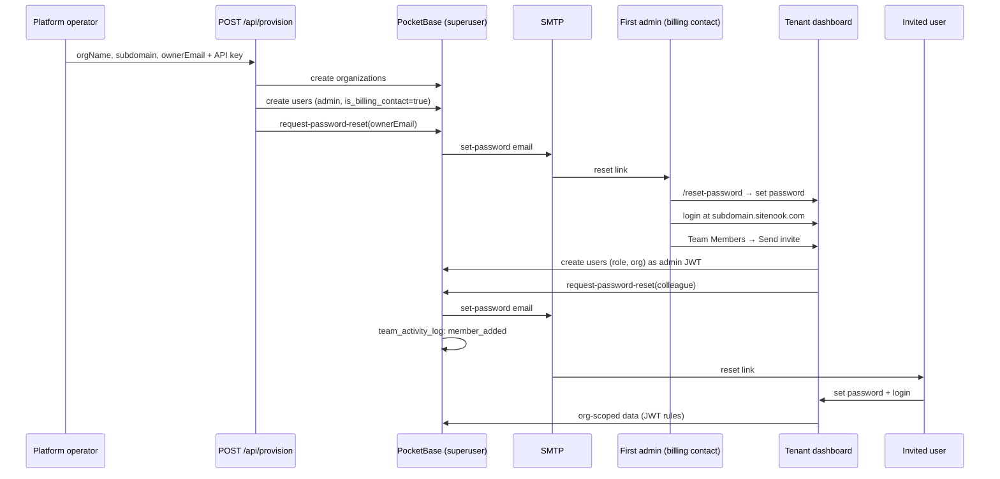

# Onboarding — account provisioning (Phase C + F)

By default, new customer organizations are provisioned by platform operators (`POST /api/provision`). Existing org **admins** invite colleagues from the dashboard.

**Phase F (optional):** When `NUXT_PUBLIC_SELF_SERVICE_SIGNUP=true`, new customers can create an organization from the apex host. **Phase G** adds marketing landing, `/pricing`, and Stripe Checkout before `/start` for paid plans. The primary marketing CTA is a **30-day Team trial** (`/start?plan=team&trial=1`, no credit card); Free remains available at 1 site / 20 pages per scan. After trial expiry the scanner downgrades the org to Free. Team member onboarding is unchanged — only admins invite colleagues.

After the first admin signs in, a dismissable **Get started** checklist appears across dashboard pages (above the feature-page banner). It tracks adding a site, inviting a teammate, and reviewing issues. Progress and dismiss are stored on `organizations.onboarding_state` (org-scoped; once dismissed it does not return).

**Self-service signup** (`/start`) collects the first admin’s email **and password** so they can sign in immediately (no setup email required). Operator `POST /api/provision` still creates an unverified admin and sends a set-password email unless you pass a password yourself.

**Docker / appliance first boot:** `APP_USER_EMAIL` / `APP_USER_PASSWORD` seed a verified admin on the default org (see `services/pocketbase/seed.sh`).

---

## Flows at a glance

| Flow | Who | How |
|------|-----|-----|
| **New organization** | Platform operator / sales | `POST /api/provision` (Nitro, API key) |
| **New organization (self-service, free)** | New customer on apex | `/pricing` → **Get started free** → `/start?plan=free` |
| **New organization (self-service, Team trial)** | New customer on apex | Landing/pricing → **Start free trial** → `/start?plan=team&trial=1` (no card; 30-day Team) |
| **New organization (self-service, paid)** | New customer on apex | `/pricing` → Stripe Checkout → `/start?checkout=cs_…&plan=team` (or `starter` / `business`) |
| **New colleague** | Org admin | Settings → Team Members → **Send invite** |
| **Set password** | Invited user | Email link → `/reset-password?setup=1` → sign in on tenant URL |
| **Public `/signup`** | Anyone | Hub: create org (if enabled) or join existing team |

---

## 1. Provision a new organization

Platform staff call the Nitro provisioning route with a shared secret. The server (PocketBase superuser) creates:

1. An `organizations` record (`name`, unique `subdomain`, `plan`)
2. The first `users` record with `role: admin`, `is_billing_contact: true`, linked to that org, **`verified: false`**
3. A PocketBase **password-reset** email (account setup copy) so the admin can choose a password

The API request/response still uses `ownerName` / `ownerEmail` field names for the first user — this is the provisioning contact, not an “Account Owner” role.

### Request

```http
POST /api/provision
Content-Type: application/json
X-Provision-Key: <NUXT_PROVISION_API_KEY>
```

```json
{
  "orgName": "Acme Agency",
  "subdomain": "acme",
  "ownerName": "Jane Smith",
  "ownerEmail": "jane@acme.example",
  "plan": "team"
}
```

`Authorization: Bearer <NUXT_PROVISION_API_KEY>` is also accepted.

### Response (201)

```json
{
  "organization": { "id": "…", "name": "Acme Agency", "subdomain": "acme" },
  "owner": { "id": "…", "email": "jane@acme.example", "name": "Jane Smith" },
  "loginUrl": "https://acme.sitenook.com/login",
  "inviteEmailSent": true
}
```

The `owner` key in the response is the provisioned first user (stored as `admin` + billing contact). If SMTP is not configured, the org and user are still created but `inviteEmailSent` is `false` — send a manual password reset from PocketBase admin or fix SMTP.

### Subdomain rules

- 2–63 characters, lowercase letters, numbers, hyphens
- Must not start/end with `-`
- Reserved: `www`, `api`, `admin`, `app`, `mail`, `smtp` (see `apps/web/app/utils/subdomain.ts`)
- Unique across `organizations.subdomain`

---

## 2. Invite a colleague (in-app)

Org **admins** open **Settings → Team Members → Send invite**.

1. Admin enters name, email, and org role (`admin` or `viewer`).
2. The app creates the user in the same organization (random temporary password — never shown, **`verified: false`**).
3. PocketBase sends an **account setup** email to the new address.
4. If the email fails (SMTP), the user record is rolled back and the admin sees an error.
5. On success, a `member_added` entry is written to `team_activity_log` (via PocketBase hook).

There is no per-site access assignment — org role alone controls read vs write (see [users-and-teams.md](./users-and-teams.md)).

### Resend invite / password reset

From the member drawer, admins can **Resend account setup email** (pending members) or **Send password reset email** (verified members). A successful resend logs `invite_resent` via `POST /api/team-activity-log`.

---

## 3. Set password and first login

1. User opens the link from email (`/reset-password?token=…&setup=1` for invites).
2. Chooses a password (min 8 characters). PocketBase sets **`verified: true`** on success.
3. Signs in at the **tenant URL**: `https://{subdomain}.{app-domain}/login` (e.g. `acme.localhost:3000` in dev).
4. Tenant middleware and login reject users who belong to a different organization.

Apex hosts (`localhost:3000`, `sitenook.com`) allow any org member to sign in when `NUXT_PUBLIC_TENANT_ONLY` is off. In production, set `NUXT_PUBLIC_TENANT_ONLY=true` so apex shows `/sign-in` instead of login (see [multi-tenancy.md](./multi-tenancy.md), [go-live.md](../operations/go-live.md)).

---

## Sequence diagram (end-to-end)



---

## Security model

| Control | Purpose |
|---------|---------|
| `users.createRule` | Only authenticated org **admin** can create users in their org — blocks public signup |
| `users_security.pb.js` + `users_security_lib.js` | Blocks self-escalation on `role` / `organization`; last-admin and last-billing-contact safeguards; activity logging |
| `NUXT_PROVISION_API_KEY` | Protects org provisioning route (not exposed to browser) |
| Superuser provisioning | First user created via admin API bypasses `createRule` (expected) |

---

## Environment variables

| Variable | Service | Purpose |
|----------|---------|---------|
| `NUXT_PROVISION_API_KEY` | web (Nitro) | Shared secret for `POST /api/provision` |
| `NUXT_PB_ADMIN_EMAIL` / `NUXT_PB_ADMIN_PASSWORD` | web (Nitro) | Superuser for provisioning + org-context |
| `NUXT_PUBLIC_APP_DOMAIN` | web | Build tenant login URLs (`acme.sitenook.com`) |
| `NUXT_PUBLIC_APP_URL` | web | Apex URL; dev port for `*.localhost` links |
| `NUXT_PUBLIC_SUPPORT_EMAIL` | web | Contact on `/signup` invite-only page |
| PocketBase SMTP | pocketbase | Required for set-password / invite emails |

### PocketBase mail + password reset template

1. **Settings → Mail settings** — configure SMTP (host, port, credentials).
2. **Collections → users → Options → Password reset template** — set the link to your dashboard (not PocketBase on port 8090):

```html
<a href="http://localhost:3000/reset-password?token={TOKEN}">Set up account</a>
```

On boot, `patch-users.sh` sets the template base URL from `APP_DASHBOARD_URL`. The PocketBase hook `mailer_tenant_reset.pb.js` rewrites outbound links to the recipient’s tenant host (e.g. `http://test-agency.localhost:3000/reset-password?token=…&setup=1`) and adjusts subject/body: **account setup** when `users.verified` is false, **reset password** when verified. After setting a password, the app’s **Go to sign in** button resolves the matching tenant login URL via `GET /api/org-login-url`.

**PocketBase mail settings** (Settings → Mail settings in `/_/`) — not stored in `.env`; configure in the admin UI and persist in `pb_data`:

| Field | Dev (Gmail app password) | Production (Resend — recommended) |
|-------|--------------------------|-----------------------------------|
| **Enabled** | On | On |
| **Host** | `smtp.gmail.com` | `smtp.resend.com` |
| **Port** | `587` | `587` (STARTTLS) or `465` (SSL) |
| **Username** | Your Gmail address | `resend` |
| **Password** | [Google app password](https://myaccount.google.com/apppasswords) | Resend API key (`re_…`) |
| **TLS** | On (STARTTLS on 587) | On |
| **From address** | Your Gmail address | `SiteNook <noreply@yourdomain.com>` (verified domain) |
| **Local name** (EHLO) | Leave blank or `localhost` | Your sending domain, e.g. `sitenook.com` |

Use **Send test email** in PocketBase after saving. Invites and password resets use the same SMTP client.

### Email deliverability

Invite and reset emails are **password-reset** messages sent by PocketBase over SMTP. They often land in **spam** when using personal Gmail SMTP in dev — that is expected and does not block local testing. Before onboarding real customers, use a **transactional provider** on a **domain you control** with SPF, DKIM, and DMARC.

#### Why dev Gmail goes to spam

- Sending from `@gmail.com` through `smtp.gmail.com` with links to `*.localhost` looks suspicious to filters.
- No aligned SPF/DKIM for your product domain.
- Low domain reputation for ad-hoc personal accounts.

Dev Gmail is fine for F1 smoke tests; do not rely on it for production.

#### Recommended: Resend (or SendGrid)

**Resend** fits SiteNook well: SMTP works with PocketBase’s built-in mailer, no code changes, and domain verification gives you DNS records to copy.

1. Create a [Resend](https://resend.com) account and **add your domain** (e.g. `sitenook.com`).
2. Add the **SPF**, **DKIM**, and **DMARC** DNS records Resend shows (usually in Cloudflare or your DNS host). Wait for verification.
3. Create an API key with **Sending access**.
4. In PocketBase **Settings → Mail settings**:

   | Field | Value |
   |-------|-------|
   | Host | `smtp.resend.com` |
   | Port | `587` |
   | Username | `resend` |
   | Password | Your API key |
   | From | `SiteNook <noreply@sitenook.com>` (must use the verified domain) |
   | Local name | `sitenook.com` |

5. Send a test email from PocketBase to an external inbox (Gmail, Outlook).

**SendGrid** (alternative): host `smtp.sendgrid.net`, port `587`, username `apikey`, password = SendGrid API key. Verify sender domain in SendGrid and add their SPF/DKIM records.

#### Alternative: Google Workspace (custom domain)

If you already use Google Workspace for `@yourdomain.com`:

1. Use `smtp.gmail.com`, port `587`, TLS on, Workspace address + app password.
2. In Google Admin → **Apps → Google Workspace → Gmail → Authenticate email**, enable **DKIM** for your domain and publish the TXT record.
3. Add **SPF** at your DNS apex: `v=spf1 include:_spf.google.com ~all`
4. Add **DMARC** (start with monitoring): `v=DMARC1; p=none; rua=mailto:dmarc@yourdomain.com`
5. Set PocketBase **From** to a Workspace address on that domain (e.g. `noreply@sitenook.com`) and **Local name** to `sitenook.com`.

Workspace is workable but more admin overhead than Resend for pure transactional invite mail.

#### DNS checklist (any provider)

| Record | Purpose |
|--------|---------|
| **SPF** (TXT at apex) | Lists which servers may send mail for your domain |
| **DKIM** (TXT/CNAME) | Cryptographic signature; provider gives exact host/value |
| **DMARC** (TXT `_dmarc`) | Policy for failed SPF/DKIM; start with `p=none` |

Exact values come from Resend, SendGrid, or Google — do not guess. After DNS propagates, re-check verification in the provider dashboard.

#### Align env vars with outbound links

Reset links must match your public app URL or tenant rewriting will point users at the wrong host:

| Variable | Service | Example (production) |
|----------|---------|----------------------|
| `APP_DASHBOARD_URL` | pocketbase | `https://sitenook.com` (apex; hook rewrites to `{subdomain}.sitenook.com`) |
| `APP_PUBLIC_DOMAIN` | pocketbase | `sitenook.com` (from `NUXT_PUBLIC_APP_DOMAIN` in compose) |
| `NUXT_PUBLIC_APP_DOMAIN` | web | `sitenook.com` |
| `NUXT_PUBLIC_APP_URL` | web | `https://sitenook.com` |

Recreate the **pocketbase** and **web** containers after changing these.

#### Deliverability verification (E2)

Run after production SMTP + DNS are configured:

1. PocketBase **Send test email** → arrives in **inbox** (not spam) on a personal Gmail or Outlook address.
2. `POST /api/provision` (or Team Members invite) → recipient receives account setup mail in **inbox**.
3. Link opens `{subdomain}.sitenook.com/reset-password?token=…&setup=1` (not raw PocketBase `:8090`).
4. Optional: [mail-tester.com](https://www.mail-tester.com) — aim for **8+/10** before go-live.

If mail still hits spam: confirm From uses the verified domain, DKIM shows **pass** in the message headers, and you are not sending from `@gmail.com` in production.

---

## Manual verification checklist

Run on a tenant host (e.g. `test-agency.localhost:3000` or `default.localhost:3000`).

1. **Rebuild** after PocketBase / web changes:
   ```bash
   docker compose -f docker-compose.yml -f docker-compose.override.yml up -d --build --force-recreate
   ```
2. Set `NUXT_PROVISION_API_KEY` on the web service and recreate the container (for provision flow).
3. `POST /api/provision` → first admin receives account setup email (or `inviteEmailSent: false` if SMTP off).
4. Admin completes `/reset-password?setup=1` → PocketBase sets `verified: true` → logs in at `{subdomain}.localhost:3000`.
5. Admin invites colleague (`admin` or `viewer`) → email → account setup link → sees only that org’s data.
6. **Billing contact:** toggle on second admin; confirm Billing badge; last-billing-contact guard blocks remove.
7. **Activity log:** confirm `member_added`, role changes, `invite_resent` entries.
8. **Wrong-org guard:** default-org user on another tenant host → rejected at login.
9. Unauthenticated `POST /api/collections/users/records` → **403** (integration test: `teamMembersCreate.test.ts`).
10. `/signup` shows invite-only message; no registration form.

### Production email (after E2)

1. Configure transactional SMTP in PocketBase (Resend or SendGrid recommended) — see [Email deliverability](#email-deliverability).
2. Verify domain SPF/DKIM/DMARC in your DNS provider.
3. Send test + real invite → confirm **inbox** delivery on an external address.

---

## Self-service organization signup (Phase F + G)

Enable after E2 inbox delivery is verified. For paid Standard plans, complete [stripe-setup.md](./stripe-setup.md) first.

```bash
NUXT_PUBLIC_MARKETING_SITE=true
NUXT_PUBLIC_SELF_SERVICE_SIGNUP=true
# Stripe (Standard plan) — see stripe-setup.md
NUXT_STRIPE_SECRET_KEY=sk_test_...
NUXT_STRIPE_TEAM_PRICE_ID=price_...
NUXT_STRIPE_WEBHOOK_SECRET=whsec_...
# Recommended in production:
NUXT_PUBLIC_TURNSTILE_SITE_KEY=...
NUXT_TURNSTILE_SECRET=...
NUXT_PUBLIC_TERMS_URL=https://sitenook.com/terms
```

| Route | Auth | Purpose |
|-------|------|---------|
| `GET /api/subdomain-available?slug=` | Public, rate-limited | Live slug check |
| `GET /api/start-access?plan=&checkout=` | Public, rate-limited | Validates `/start` access (free / paid / dev bypass) |
| `POST /api/stripe/create-checkout-session` | Public, rate-limited | Starts Stripe Checkout for Standard |
| `POST /api/stripe/webhook` | Stripe signature | Stores paid sessions in `stripe_checkout_sessions` |
| `POST /api/signup-organization` | Public, rate-limited | Creates org + first admin; **`plan`** from checkout path (`free`, `starter`, `team`, or `business`) |

- Apex only — tenant hosts never show org creation.
- `/signup` hub: **Create an organization** → `/pricing` · **Join existing team** → `/sign-in`.
- Bare `/start` redirects to `/pricing` — customers pick a plan first.
- `POST /api/provision` remains for operators (`created_via: provision_api`; default plan `team` unless specified).
- Colleague onboarding unchanged — Settings → Team Members only.

**Manual smoke:** see [stripe-setup.md](./stripe-setup.md) § End-to-end smoke test (G9).

---

## Key files

| Area | Path |
|------|------|
| Provisioning API | `apps/web/server/api/provision.post.ts` |
| Self-service signup API | `apps/web/server/api/signup-organization.post.ts`, `subdomain-available.get.ts` |
| Provisioning logic | `apps/web/server/utils/provisioning.ts` |
| Signup wizard | `apps/web/app/pages/start.vue`, `components/auth/CreateOrganizationWizard.vue` |
| Dashboard checklist | `apps/web/app/components/shared/OnboardingChecklist.vue`, `composables/useOnboarding.ts`, `utils/onboardingChecklist.ts` |
| Onboarding state API | `apps/web/server/api/onboarding-state.post.ts` |
| Stripe checkout + webhook | `apps/web/server/api/stripe/`, `server/utils/stripe*.ts`, `startAccess.ts` |
| Checkout records | PocketBase `stripe_checkout_sessions` (migration `1730000029`) |
| API key guard | `apps/web/server/utils/requireProvisionKey.ts` |
| Team invite UI | `apps/web/app/components/settings/TeamMemberAddModal.vue` |
| Team invite composable | `apps/web/app/composables/useTeamMembers.ts` |
| Activity log API | `apps/web/server/api/team-activity-log.post.ts` |
| Invite-only signup page | `apps/web/app/pages/signup.vue` |
| Users create rule (boot patch) | `services/pocketbase/patch-users.sh` |
| Security hooks | `services/pocketbase/pb_hooks/users_security.pb.js`, `users_security_lib.js` |
| Integration tests | `apps/scanner/tests/integration/teamMembersCreate.test.ts`, `usersHooks.test.ts` |
| Unit tests | `apps/web/tests/unit/server/provisioning.test.ts`, `apps/web/tests/unit/utils/onboardingChecklist.test.ts` |

---

## Related

- [authentication.md](./authentication.md) — login, JWT, collection rules
- [multi-tenancy.md](./multi-tenancy.md) — subdomain routing
- [users-and-teams.md](./users-and-teams.md) — org roles, billing contact, team management UI
- [CURRENT_TASK.MD](../CURRENT_TASK.MD) — phase tracking
- [go-live.md](../operations/go-live.md) — production deployment checklist
- [stripe-setup.md](./stripe-setup.md) — Stripe test mode, Standard price, dev bypass
