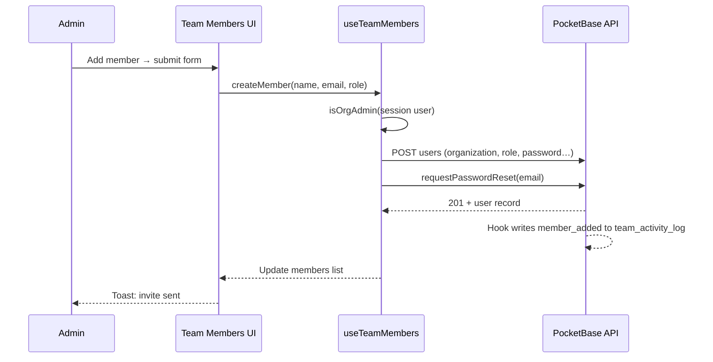
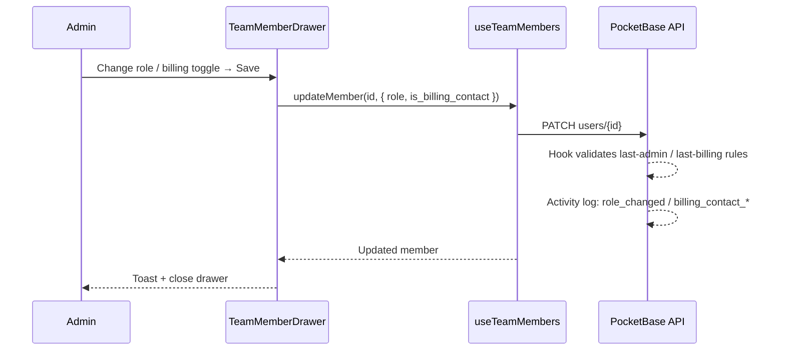
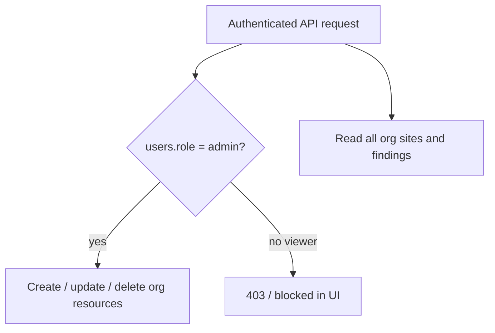

# Users and team management

This document describes how **dashboard users** are modeled, authorized, and managed in AccessIQ. It covers the PocketBase `users` collection, organization-scoped roles, billing contacts, the Team Members UI, and how org roles relate to site data access.

For sign-in, tokens, and guest routes, see [authentication.md](./authentication.md). For provisioning new organizations, see [onboarding.md](./onboarding.md).

---

## 1. Overview

AccessIQ users are PocketBase auth records in the built-in **`users`** collection. Each user belongs to exactly one **organization** and has an org-level **role** that controls team administration and write access to org resources.

| Concern | Where it lives |
|---------|----------------|
| Identity (email, password, JWT) | PocketBase `users` (auth collection) |
| Tenant boundary | `users.organization` → `organizations` |
| Org-wide role | `users.role` (`admin` or `viewer`) |
| Billing contact flag | `users.is_billing_contact` (boolean; admins only) |
| Team management UI | **Settings → Team Members** (`/settings/users`) |
| Team activity audit | `team_activity_log` collection + Activity log modal |

Public self-registration on `/signup` redirects to self-service or sign-in when marketing flags are enabled. New organizations use `POST /api/provision` (operator) or `/start` (self-service). Colleagues are invited by org **admins** on the Team Members page.

Legacy `owner` and `analyst` role values are migrated to `admin` / `viewer` on boot (migration `1730000026`, `patch-users.sh`).

---

## 2. Data model

### `users` collection

PocketBase ships the auth collection as `users` (`_pb_users_auth_`). AccessIQ extends it with:

| Field | Type | Purpose |
|-------|------|---------|
| `email` | auth email | Login identity |
| `password` | auth | Hashed by PocketBase |
| `name` | text | Display name in the dashboard |
| `organization` | relation → `organizations` | Tenant the user belongs to |
| `role` | select | Org-level role: `admin` or `viewer` |
| `is_billing_contact` | bool | Receives billing-related communication (admins only) |
| `verified` | system | Email verified flag |

Minimum password length is **8 characters** (PocketBase options + form validation).

### Organizations

Every user must have `organization` set after multi-tenant backfill. Users only **list and view** colleagues in the same organization. Cross-org access is blocked by PocketBase API rules and tenant host guards.

### Org user roles

| `users.role` | Label in UI | Team management | Site / scan data |
|--------------|-------------|-----------------|------------------|
| **`admin`** | Admin | Full team admin (add, edit, remove, billing toggle) | Read/write for all org sites |
| **`viewer`** | Viewer | Read-only team list + activity log | Read-only for all org sites |

### Billing contact

Billing is **not** a role. It is a separate boolean on admin users:

- Any number of admins may have `is_billing_contact = true`.
- Only **admins** can be billing contacts (viewers cannot).
- The org must always have **at least one** billing contact (enforced by hook + UI).
- Shown in the member table as a **Billing** badge next to the role badge.

Provisioning sets the first org user to `role: admin` and `is_billing_contact: true`.

### Safeguards

| Rule | Enforcement |
|------|-------------|
| Last admin | Cannot demote or remove the only `admin` in the org |
| Last billing contact | Cannot clear billing contact, demote, or remove the only billing contact unless another admin is assigned first |
| Self role change | Users cannot change their own `role` |
| Self delete | Users cannot delete their own account via Team Members |

**Org-wide access model:**

- Every org member can **view** all sites in their organization.
- Only **`admin`** can create, edit, or delete org resources (sites, scans, policies, team members, etc.).
- The legacy **`site_access`** join collection remains in the schema but is **deprecated** and not used in API rules.

---

## 3. PocketBase API rules and hooks

Rules are re-synced on every boot via `patch-users.sh`. Security hooks live in:

- `services/pocketbase/pb_hooks/users_security.pb.js`
- `services/pocketbase/pb_hooks/users_security_lib.js` (shared logic; required because PocketBase hook handlers run in isolated scopes)

| Rule | Expression (summary) |
|------|----------------------|
| **listRule** | `organization = @request.auth.organization` |
| **viewRule** | `organization = @request.auth.organization` |
| **createRule** | Authenticated org **admin**; new record’s `organization` must match caller’s org |
| **updateRule** | Self-update **or** (org admin updating a user in the same org) |
| **deleteRule** | Org admin may delete users in same org, except **self** (hook enforces last-admin / last-billing-contact) |

### Hook behaviour

| Action | Behaviour |
|--------|-----------|
| Change `organization` | Rejected for all non-superuser requests |
| Change `role` | Admin only; validates `admin` or `viewer`; blocks last-admin demotion |
| Set `is_billing_contact` | Admin only; viewers cannot be billing contacts; blocks clearing last billing contact |
| Demote admin → viewer | Auto-clears `is_billing_contact` when allowed (not when last billing contact) |
| Delete user | Admin only; blocks self-delete, last admin, last billing contact |
| Create user | Role must be `admin` or `viewer`; admin caller only |

### Team activity log (`team_activity_log`)

| Field | Purpose |
|-------|---------|
| `organization` | Org scope |
| `actor` | User who performed the action |
| `target` | User affected |
| `action` | `member_added`, `member_removed`, `role_changed`, `billing_contact_added`, `billing_contact_removed`, `invite_resent` |
| `details` | JSON (e.g. `{ from: "viewer", to: "admin" }`) |

- **Read:** any org member (`listRule` / `viewRule` = `organization = @request.auth.organization`)
- **Write:** hooks (superuser) + `POST /api/team-activity-log` for `invite_resent` only (Nitro route uses admin credentials)

The scanner worker and bootstrap scripts use **superuser** credentials and bypass these rules.

---

## 4. Team Members UI (`/settings/users`)

Route: **Settings → Team Members** (`app/pages/settings/users.vue`).

### Who sees what

| Viewer | Behaviour |
|--------|----------|
| **Any org member** | Searchable table, **Activity log** button |
| **Org admin** | Info card, **Add member**, row checkboxes, bulk **Edit** / **Remove selected**, member edit drawer |
| **Viewer** | Read-only table; message to contact an admin for changes |

The signed-in user’s row appears **first** (with a **You** badge). Pending invites show **Pending** when `verified: false`. Billing contacts show a **Billing** badge.

The page waits for **`awaitAuthReady()`** before rendering admin controls.

### Member table

Component: `TeamMembersTable.vue`

- Columns: checkbox (admins only), name, email, role (+ Billing badge).
- Click a row to open the edit drawer.
- Checkboxes enable bulk remove via `TableSelectionBar`.
- Row selection is unrestricted; bulk remove validates last-admin / last-billing-contact rules and blocks with a clear error.

### Activity log

Component: `TeamActivityLogModal.vue`

- Button in the toolbar (left of **Add member**).
- Paginated list (20 per page), newest first.
- Read-only for all org members.

### Add member

Component: `TeamMemberAddModal.vue`

Admins submit:

- Full name
- Work email
- Organization role (`Admin` or `Viewer`)

Flow (`useTeamMembers().createMember()`):

1. Creates the user with `organization` set to the admin’s org and a random temporary password (never shown).
2. Calls PocketBase `requestPasswordReset` for the account setup email (tenant-aware when configured).

If SMTP fails, the user record is rolled back. See [onboarding.md](./onboarding.md).

### Edit member (drawer)

Component: `TeamMemberDrawer.vue`

Right-hand drawer opened by clicking a row or bulk **Edit** (single selection).

**Fields:**

- Full name
- Work email
- Organizational role (`Admin` / `Viewer`) — grouped with billing in a bordered panel
- **Billing contact** toggle (admins only; disabled with hint when last billing contact)

**Account access** (other members only):

- **Resend account setup email** when `verified: false`
- **Send password reset email** when verified

**Footer:**

| Position | Buttons |
|----------|---------|
| Left | **Save**, **Cancel** |
| Right | **Remove** — hidden when removal is blocked (warning alert explains why) |

**Remove confirmation** uses an inline alert in the drawer (not a separate modal). Bulk remove uses a confirmation modal.

### Sign-up page

`/signup` does **not** create users. It shows an invite-only message and support email from `NUXT_PUBLIC_SUPPORT_EMAIL`.

---

## 5. Application code map

| File | Role |
|------|------|
| `app/pages/settings/users.vue` | Team Members page, activity log, drawer orchestration |
| `app/components/settings/TeamMembersTable.vue` | Member table + selection |
| `app/components/settings/TeamMemberDrawer.vue` | Edit drawer (role, billing, remove) |
| `app/components/settings/TeamMemberAddModal.vue` | Invite form |
| `app/components/settings/TeamActivityLogModal.vue` | Activity log modal |
| `app/composables/useTeamMembers.ts` | CRUD, `fetchActivityLog`, invite resent logging |
| `app/utils/orgAccess.ts` | `canWriteOrg`, `canChangeRole`, `canRemoveMember`, `canToggleBillingContact` |
| `app/utils/teamActivityLog.ts` | Format activity sentences for UI |
| `server/api/team-activity-log.post.ts` | Log `invite_resent` (admin-only Nitro route) |
| `services/pocketbase/pb_hooks/users_security.pb.js` | Hook entry points |
| `services/pocketbase/pb_hooks/users_security_lib.js` | Shared hook logic |
| `services/pocketbase/pb_migrations/1730000026_team_roles_billing_contact.js` | Role migration + activity log collection |
| `services/pocketbase/patch-users.sh` | Rules, fields, legacy role migration |

### Tests

| Test | Coverage |
|------|----------|
| `apps/web/tests/unit/composables/useTeamMembers.test.ts` | Fetch, create, update, billing, activity log |
| `apps/web/tests/unit/utils/orgAccess.test.ts` | Admin/viewer, billing contact, last-admin guards |
| `apps/web/tests/unit/utils/teamActivityLog.test.ts` | Activity sentence formatting |
| `apps/scanner/tests/integration/usersHooks.test.ts` | Hook safeguards + activity log writes |
| `apps/scanner/tests/integration/teamMembersCreate.test.ts` | createRule: admin allowed, viewer denied |
| `apps/scanner/tests/unit/db/teamRoleMigration.test.ts` | Legacy role → admin/viewer mapping |

---

## 6. Flow diagrams

### Admin adds a team member



### Admin edits role and billing contact



### How org role controls data access



---

## 7. Install and operations

### Default app user (seed)

On PocketBase boot, `seed.sh` creates (or updates) the user from env:

- `APP_USER_EMAIL` / `APP_USER_PASSWORD`
- `role: admin`
- `is_billing_contact: true` if no other billing contact exists in the org
- `organization`: default org
- `verified: true`

`patch-users.sh` re-syncs password, role, and billing contact on every startup.

### Rebuild after PocketBase hook or rule changes

```bash
docker compose -f docker-compose.yml -f docker-compose.override.yml up -d --build --force-recreate pocketbase
```

Restart the **web** dev server after frontend changes.

### Manual user management

PocketBase admin UI (`/_/`) → **users** collection: full superuser control.

---

## 8. Troubleshooting

| Symptom | Likely cause | Fix |
|---------|--------------|-----|
| No **Add member** button | `users.role` is not `admin` | Set role in PocketBase admin, or use seeded `APP_USER_EMAIL` |
| Create returns **403** | Caller is not org admin, or rules not patched | Rebuild PocketBase; verify `users.createRule` |
| Create returns **400** / hook error | Duplicate email, invalid role, or hook bug | Check PocketBase Logs; verify role is `admin` or `viewer` |
| **Failed to save member** | Last-admin or last-billing-contact rule | Assign another admin / billing contact first |
| Role dropdown disabled | Editing yourself, or last admin | Expected — promote another member first |
| **Remove** hidden + warning | Last admin or last billing contact | Expected — see warning alert text |
| Activity log empty | New org or superuser-only changes | Perform an admin action (invite, role change) |
| Invite email in spam | Dev SMTP / no SPF-DKIM | See [onboarding.md](./onboarding.md) § Email deliverability |
| Viewer can edit in UI | Stale session role | Sign out and back in; verify `users.role` in PocketBase |

---

## 9. Billing and organization closure

Org **admins** manage billing and closure (not viewers).

| Action | Where | Notes |
|--------|-------|-------|
| Manage Stripe subscription | **Settings → Billing** | Opens Stripe Customer Portal when `stripe_customer_id` is set |
| Close organization | **Settings → General** → Danger zone | Soft close — blocks all users; 30-day data retention |
| Remove team member | **Settings → Team** | Unchanged — does not close the org |

See [account-closure.md](./account-closure.md) for closure flow, purge job, and APIs.

---

## 10. Related documentation

- [authentication.md](./authentication.md) — Login, JWT, collection rules, security hook summary
- [onboarding.md](./onboarding.md) — Provisioning, invite emails, tenant reset links
- [multi-tenancy.md](./multi-tenancy.md) — Subdomain routing, apex vs tenant hosts
- [CURRENT_TASK.MD](../CURRENT_TASK.MD) — Phase tracking and next steps
- [tables.md](../design/tables.md) — Table UI patterns
- [modals.md](../design/modals.md) — Modal layout
