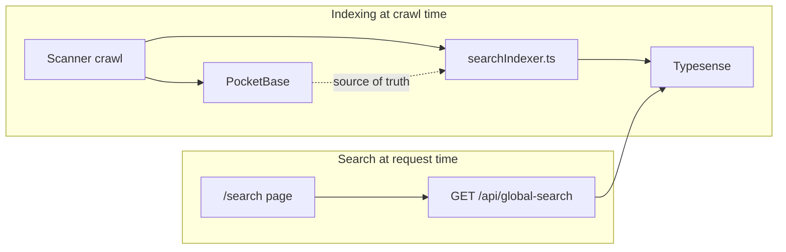

# Global search (Typesense)

Cross-site full-text search over latest-crawl **webpage HTML** and **PDF body text**, with org/site/type filters and Contains / Exact / Regex modes.

**Status:** Implemented (2026-06). PocketBase is the source of truth; Typesense holds a denormalized search projection only.

---

## Architecture



1. Index updates happen in the **scanner** at crawl time (not during user search).
2. One Typesense document per **latest webpage URL** per site (deduped via `urlKey`).
3. One Typesense document per **PDF** (`pdf_documents`).
4. If Typesense data is lost, re-run `npm run reindex-search` — PocketBase is authoritative.

---

## Community / Self-host distribution

For the public Community compose stack, Typesense is **not** enabled by default and is pulled only as the official `typesense/typesense` image under the optional Compose `search` profile. SiteNook application images do not vendor Typesense binaries — see [public-sku-sheet.md](../platform/public-sku-sheet.md) and `deploy/community/`.

## Infrastructure

Typesense runs as a Docker Compose service (`typesense/typesense:27.1`, volume `typesense_data`).

| Variable | Services | Purpose |
|----------|----------|---------|
| `TYPESENSE_URL` | web, scanner | e.g. `http://typesense:8108` |
| `TYPESENSE_API_KEY` | web, scanner | Admin/search API key |
| `TYPESENSE_ENABLED` | web, scanner | `1` to use Typesense; `0` returns 503 from search API |

---

## Collection schema

**Collection name:** `search_documents`

| Field | Type | Notes |
|-------|------|-------|
| `id` | string | `webpage:{pageId}` or `pdf:{pdfDocumentId}` |
| `orgId`, `siteId`, `type` | facet | Multi-tenant filters |
| `url`, `urlKey` | string | Normalized URL for dedup |
| `title`, `body` | string | `body` uses infix indexing (200KB cap) |
| `pdfAuthor`, `pdfSubject`, … | string | Flattened PDF metadata |
| `lastScannedAt` | int64 | Sort + display |

---

## Indexing (scanner)

Modules under `apps/scanner/src/search/`:

| File | Role |
|------|------|
| `typesenseClient.ts` | Client config; ensure collection exists |
| `searchDocument.ts` | Build Typesense doc from PB page/PDF record |
| `searchIndexer.ts` | Upsert, delete stale, reconcile latest-per-URL |

**Hook points:** `savePageResult.ts`, `finalizeScan.ts`, `indexPdfSearchContent.ts`, `validatePdfDocument.ts`, `scanRetention.ts`.

---

## Search API (web)

| File | Role |
|------|------|
| `server/api/global-search.get.ts` | Authenticated entry |
| `server/utils/runGlobalSearch.ts` | Typesense query orchestration |
| `server/utils/searchQuery.ts` | Mode mapping, snippets, regex fallback |

| UI mode | Strategy |
|---------|----------|
| **Contains** | Infix search on `title`, `body`, `url`, PDF metadata fields |
| **Exact** | Quoted phrase + `drop_tokens_threshold=0` |
| **Regex** | Filter by org/site/type; apply regex to indexed `body` server-side (capped at `MAX_SCAN_RECORDS`) |

Tenancy: always `filter_by=orgId:={userOrgId}`. No silent fallback to PocketBase full-table scans.

---

## Backfill

```powershell
cd apps\scanner
npm run reindex-search
npm run reindex-search -- --site=SITE_ID
npm run reindex-search -- --org=ORG_ID
```

Run after deploy or Typesense volume loss.

---

## Risks and limitations

| Topic | Notes |
|-------|-------|
| **GPL-3.0** | Typesense is GPL-3.0 — legal review if shipping a closed appliance |
| **Regex at scale** | Capped fetch; document in UI tooltip |
| **Index lag** | Search reflects last completed crawl, not live site |

---

## Related

- [operations/commands.md](../operations/commands.md) — `reindex-search` command
- [product/pdf-accessibility.md](./pdf-accessibility.md) — PDF text extraction
- [product/scans.md](./scans.md) — crawl hooks that feed the index
