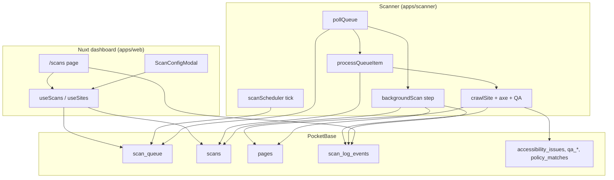
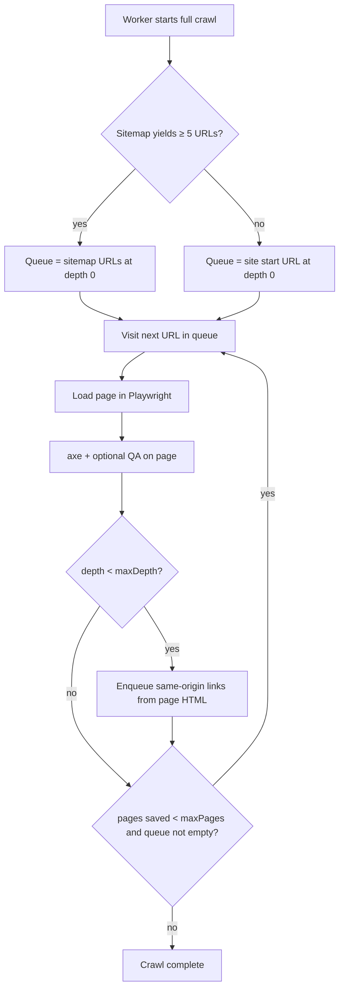

# Scans and crawl pipeline

AccessIQ runs site crawls asynchronously: the **web dashboard** enqueues work in PocketBase, and the **scanner worker** claims jobs, crawls with Playwright + axe-core, and writes results back. This document describes the queue, active scans, history, configuration, cancellation, scheduling, and live logging end to end.

## Architecture overview



| Layer | Role |
|-------|------|
| `scan_queue` | Durable job queue: one row per requested crawl before work starts |
| `scans` | Scan run record: created when the worker starts; holds status, scores, config snapshot |
| `pages` + finding collections | Per-page crawl output (issues, links, spelling, etc.) |
| `scan_log_events` | Append-only live crawl log lines for the dashboard |
| Scanner | Admin-authenticated worker; polls queue, runs crawls, updates both collections |
| Web app | Authenticated users enqueue scans, view active jobs, expand per-site history |

---

## PocketBase collections

Schema is defined in `services/pocketbase/pb_migrations/` and applied on Docker via `bootstrap.sh` + `patch-*.sh` scripts (not only raw migrations). Key collections:

### `scan_queue`

| Field | Purpose |
|-------|---------|
| `site` | Target site (relation, cascade delete) |
| `status` | `pending` → `processing` → `complete` \| `failed` \| `cancelled` |
| `scan_type` | `full`, `accessibility_only`, or `qa_only` |
| `priority` | Higher first when claiming (sort: `-priority,id`) |
| `requested_by` | User who queued (manual scans) |
| `target_url` | Optional single-URL override |
| `raw_config` | JSON overrides merged with site `default_scan_config` |

**API rules:** authenticated users may create/list/view; updates are reserved for the scanner (empty `updateRule` in bootstrap — scanner uses admin credentials).

### `scans`

| Field | Purpose |
|-------|---------|
| `site` | Parent site |
| `status` | See [Scan run lifecycle](#scan-run-scans) below (`running`, `background_scan`, `complete`, `complete_with_errors`, `failed`, `cancelled`) |
| `scan_type` | Mirrors queue item |
| `pages_crawled` | Updated during crawl and background retries |
| `started_at` / `completed_at` | Run timing (`completed_at` set when scan reaches a terminal status) |
| `wcag_version`, `score_overall`, `score_a`, `score_aa`, `score_aaa`, `score_best_practices`, `score_qa` | Aggregated results (from primary crawl; not recomputed after background) |
| `raw_config` | Config snapshot used for the run (cleared on retention prune) |
| `diff_summary` | Optional comparison vs previous complete scan |
| `error_message` | Failure text when `failed`, or summary when `complete_with_errors` |
| `open_issue_count` | Count of open accessibility issues at completion |
| `unscanned_urls` | JSON array of URLs that could not be loaded (HTTP 403 after retries, etc.) |
| `background_retry` | JSON state for background phase: `{ round, index, queue }` while `status = background_scan` |

A `scans` row is **not** created until the worker begins processing a queue item. While status is `pending` on the queue only, the UI shows an **active scan row** sourced from `scan_queue`, not `scans`.

### `scan_log_events`

| Field | Purpose |
|-------|---------|
| `scan`, `site` | Relations |
| `level` | `info`, `success`, `warn`, `error` |
| `message` | Log line (max 2000 chars) |
| `url` | Optional page URL |

Created by the scanner (`ScanLogWriter`); read by the web app (`useLiveCrawlLog`). Requires `patch-scan-log-events.sh` / migration `1730000014` on existing deployments.

### Related output collections

Each saved page creates rows in `pages`, `accessibility_issues`, and optionally `qa_broken_links`, `qa_spelling`, `qa_inventory`, `policy_matches` depending on scan config.

---

## Status lifecycles

### Queue item (`scan_queue`)

```
pending ──(worker claims)──► processing ──► complete
                │                │
                │                ├──► failed
                │                └──► cancelled
                └──► cancelled (before/during claim)
```

### Scan run (`scans`)

```
(running) ──► complete
         ├──► background_scan ──► complete
         │                   └──► complete_with_errors
         ├──► failed
         └──► cancelled
```

| Status | Meaning |
|--------|---------|
| `running` | Primary crawl in progress |
| `background_scan` | Primary crawl finished; worker is retrying blocked URLs (see [Background scan](#background-scan-waf-retries)) |
| `complete` | All targeted pages saved successfully |
| `complete_with_errors` | Run finished but one or more URLs remain in `unscanned_urls` after background retries |
| `failed` | Worker error or unrecoverable failure |
| `cancelled` | User stopped the run (partial pages may remain) |

**Important:** For one job, both collections are involved:

1. User or scheduler creates `scan_queue` with `status: pending`.
2. Worker sets queue to `processing`, creates `scans` with `status: running`.
3. On primary crawl success with **no** blocked URLs: scan → `complete`, queue → `complete`.
4. On primary crawl success with **blocked URLs** (typically HTTP 403): scan → `background_scan`, queue → **`complete`** (frees the worker to process other pending jobs).
5. Background worker retries unscanned URLs when the queue is idle; final scan → `complete` or `complete_with_errors`.
6. On failure: scan → `failed`, queue → `failed`.
7. On cancel: scan → `cancelled`, queue → `cancelled` (partial pages may remain).

The dashboard **deduplicates** the active table: if a site has a `processing` queue row and a `running` or `background_scan` scan, only the **scan** row is shown (`useScans` `activeRows` computed).

---

## Scanner worker

**Entry:** `apps/scanner/src/index.ts`

### Startup

1. Authenticate to PocketBase with admin env credentials.
2. `recoverStaleJobs()` — fix orphaned `processing` queue rows and `running` scans after crashes.
3. `startSchedulerLoop()` — periodic enqueue for scheduled sites.
4. `pollLoop()` — claim and process queue items.

### Queue polling

- Interval: `SCANNER_POLL_INTERVAL_MS` (default 10s; docker-compose often 10s).
- Each tick (when not already busy):
  1. **Claim a `pending` queue item** if any exist (sort `-priority,id`, optimistic update to `processing`, re-read to confirm).
  2. If no pending items, run **one background-scan step** for the oldest `scans` row with `status = background_scan` (see [Background scan](#background-scan-waf-retries)).
- Only one of primary crawl or background step runs at a time per process (`isProcessingQueue` guard).
- **Pending queue jobs always take priority** over background retries; background work resumes when the queue is idle.
- Concurrency inside a crawl is controlled by scan config `concurrency` (Playwright pages), not multiple queue workers.

### `processQueueItem(queueId)`

High-level steps:

1. Load queue item + expanded site; exit if already `cancelled`.
2. Merge `site.default_scan_config` with `queue.raw_config` → `parseRawConfig()`.
3. Cap `maxPages` with `MAX_PAGES_PER_SCAN` env.
4. Create `scans` row (`running`), launch Chromium.
5. Decide how URLs enter the crawl queue (see [How crawls discover pages](#how-crawls-discover-pages)).
6. `crawlSite()` — visit queue URLs, optionally discover more links on each page; `onPageComplete` persists findings; `ScanLogWriter` streams live log lines. URLs that fail with HTTP ≥ 400 (after WAF retries) are recorded in crawl diagnostics as `unscannedUrls` (403 only are queued for background).
7. Poll `isScanCancelled(scanId)` during crawl; honor abort.
8. Aggregate scores (`aggregateScores()` → `score_overall`, level scores, `score_best_practices`, `score_qa`, `score_denominators`), optional `diffScans` vs previous complete scan.
9. `pruneSupersededScanDetails()` — retention (see below); set queue to `complete`.
10. If `unscannedUrls.length > 0`: update scan to `background_scan` with `unscanned_urls` and `background_retry` state; **return** (queue already complete).
11. Otherwise update scan to `complete` (or `failed` / `cancelled` if applicable).

Background retries are handled by `processBackgroundScanStep()` in `apps/scanner/src/crawler/backgroundScan.ts` on idle poll ticks—not inside `processQueueItem`.

### Scheduled scans

**Module:** `apps/scanner/src/scheduler/scanScheduler.ts`

- Tick interval: `SCHEDULER_TICK_MS` (default 60s).
- Loads sites where `crawl_schedule` is not `manual`.
- **On worker startup**, `reconcileSchedulesOnStartup()` runs first: initializes missing `schedule_next_run_at`, and for sites that are overdue but idle, rolls the next run forward **without** enqueueing (avoids a burst of scans after container restart).
- The first scheduler tick is deferred by one interval so reconcile completes before any enqueue.
- For each due site (`schedule_next_run_at`), if not busy, calls `enqueueScheduledScan()`.
- Creates queue row with site's `default_scan_config`; updates `schedule_last_enqueued_at` and `schedule_next_run_at`.
- `isSiteDue()` returns false when `schedule_next_run_at` is missing (not treated as immediately due).
- Schedule math is shared with the web app via `scheduleNextRun` utils (scanner + `apps/web/app/utils/scheduleNextRun.ts`).

### Stale job recovery

On worker start:

| Condition | Action |
|-----------|--------|
| Queue `processing` but latest site scan is terminal | Set queue status to match latest scan |
| Queue `processing` but no terminal scan | Reset queue to `pending` |
| Scan `running` with no live worker | Mark scan `failed` with “worker restarted” message |

Rows in `background_scan` are **not** reset on worker restart; they resume when the worker polls again (state in `background_retry`).

---

## Background scan (WAF retries)

Government and enterprise sites often return **HTTP 403** from a Web Application Firewall (WAF) when crawlers request pages too quickly. Users may see a block page in a browser that clears after waiting and refreshing—AccessIQ models that with **in-crawl retries** and a **background phase**.

### In-crawl WAF handling

**Module:** `apps/scanner/src/crawler/wafRetry.ts` (used from `siteCrawler.ts` and `scanPage.ts`)

When the first navigation returns **403**:

1. Log `HTTP 403 (WAF) — retry 1/2 in 5s`, wait **5 seconds**, retry with `load`.
2. Log `HTTP 403 (WAF) — retry 2/2 in 5s`, wait **5 seconds**, retry again.
3. If still failing, log `HTTP 403 — page not scanned` and add the URL to `CrawlDiagnostics.unscannedUrls` (not saved to `pages`).

Other HTTP ≥ 400 responses are logged and skipped but are **not** added to the background queue (only 403).

### Transition to `background_scan`

After the primary crawl:

- If `unscannedUrls` is empty → scan goes straight to `complete`.
- If not → scan status becomes `background_scan`, fields are set:
  - `unscanned_urls`: copy of blocked URLs
  - `background_retry`: `{ round: 1, index: 0, queue: [...] }`
- Queue item is already `complete` so **other sites’ pending scans run first**.

### Background retry rounds

**Constants** (`backgroundScan.ts`):

| Constant | Value |
|----------|--------|
| `BACKGROUND_SCAN_ROUNDS` | 3 |
| `BACKGROUND_URL_INTERVAL_MS` | 20_000 (20s between URLs) |
| `WAF_FORBIDDEN_RETRY_DELAYS_MS` | 5_000, 5_000 (same 5s+5s retries per URL) |

Each idle poll tick processes **at most one URL** for the oldest `background_scan`:

1. Re-check for `pending` queue items; exit if any (priority to new work).
2. Load scan, site, and `raw_config` snapshot.
3. If `index > 0`, wait 20s (logged), then retry the URL with `scanOnePage()` (axe + QA if configured).
4. On success: persist page, remove URL from `unscanned_urls`, increment `pages_crawled`.
5. On failure: keep URL in `unscanned_urls`.
6. When all URLs in the current round are tried:
   - If `round < 3` and URLs remain → start next round (`round++`, `index = 0`, `queue = remaining unscanned`).
   - If `round === 3` or no URLs left → finalize.

**Finalize:**

- No remaining unscanned URLs → `status: complete`, `completed_at` set, `background_retry` cleared.
- URLs still blocked → `status: complete_with_errors`, `unscanned_urls` preserved, `error_message` summarizes count.

Live log events (`scan_log_events`) record round starts, 20s waits, per-URL attempts, and completion.

### Operational tips (WAF-heavy sites)

| Recommendation | Why |
|----------------|-----|
| Wait strategy **Fixed delay 10s (WAF-friendly)** (`delay10s`) | 10s pause after each successful page load before checks |
| **Concurrency 1** | Avoids parallel requests that trigger rate limits |
| Request **WAF allowlisting** for scanner egress IP | Only durable fix for strict gov firewalls (e.g. DECYP) |
| Custom **User-Agent** matching a real browser | May help bot scoring; combine with delay/concurrency |

Legacy config value `delay5s` is normalized to `delay10s` on parse (both use a 10s post-load delay).

---

## Scan configuration

Configuration is JSON stored on **sites** (`default_scan_config`) and optionally overridden per queue item (`raw_config`). A snapshot is copied to `scans.raw_config` when the worker starts (see your example record below).

| Source | Used when |
|--------|-----------|
| Site default | New sites, scheduled scans, “Configure” saved defaults |
| Queue `raw_config` | Manual scan from modal, rescan, per-run overrides |
| Env `MAX_PAGES_PER_SCAN` | Hard cap applied in worker (`maxPages` cannot exceed this) |

**Parsing:** `apps/scanner/src/config/scanConfig.ts` (worker) and `apps/web/app/utils/scanConfig.ts` (UI) — keep in sync.

`scan_type` (`full` / `accessibility_only` / `qa_only`) is derived from which checks are enabled (axe vs QA modules). It is separate from `mode` (how URLs are discovered).

---

## How crawls discover pages

This is the most common question: **does a scan only use the sitemap, or does it follow links on the site?**  
It depends on `raw_config.mode`.

### Quick answer for `mode: "full"`

**Both, in sequence — not either/or.**

1. The worker may **seed** the crawl queue from `sitemap.xml` (when the sitemap yields at least **5** URLs after filtering).
2. Regardless of seeding, **full mode always follows `<a href>` links** on each successfully loaded page, up to `maxDepth`, subject to `stayOnDomain`, include/exclude patterns, and `robots.txt`.
3. The crawl stops when `maxPages` successful saves is reached, the queue is exhausted, the scan is cancelled, or the worker aborts.

So a “full” scan is **not** a sitemap-only scan. Sitemap-only behaviour is `mode: "sitemap"`.



### Crawl modes compared

| `mode` | Queue seed | Follows links on pages? | Typical use |
|--------|------------|-------------------------|-------------|
| **`full`** | Site URL, **or** sitemap URLs if ≥ 5 found (`MIN_SITEMAP_SEED_URLS` in `crawlSeeds.ts`) | **Yes** — always | Default site audit; discovers pages sitemaps miss |
| **`sitemap`** | **Only** URLs from `sitemapUrl` (default `{origin}/sitemap.xml`) | **No** — visits listed URLs only | Known URL list from XML; no link discovery |
| **`pages`** | **Only** URLs in `pages[]` | **No** | Spot-check specific URLs |

**Overrides (any mode):**

| Override | Effect |
|----------|--------|
| `target_url` on queue item | Single URL only; ignores mode list/sitemap |
| `mode: "pages"` with URLs in config | Exact list only |

### Full mode — implementation detail

**Code path:** `apps/scanner/src/index.ts` (`processQueueItem`) → `buildUrlQueue` / `trySitemapSeedUrls` → `apps/scanner/src/crawler/siteCrawler.ts` (`crawlSite`).

1. **`buildUrlQueue`** returns a fixed list only for `pages` or `sitemap` mode. For `full`, it returns `[]` (no fixed list).
2. If `mode === 'full'` and there is no `target_url`, the worker calls **`trySitemapSeedUrls`** using `sitemapUrl` or `{site-origin}/sitemap.xml`.
3. If at least **5** URLs survive include/exclude filtering (`shouldUseSitemapSeeds`), those URLs become **`initialUrls`** at crawl depth `0`. Scanner log: `Full crawl: seeding N URL(s) from sitemap`. Live log: `Seeded N URL(s) from sitemap (also following links)`.
4. If the sitemap is missing, empty, or has fewer than 5 URLs, the queue starts with the **site’s start URL** only (depth `0`).
5. In `crawlSite`, `followLinks` is `true` when `mode === 'full'`. After each successful page load, **`extractLinks`** collects `a[href]` values, keeps same-origin links when `stayOnDomain` is true, applies include/exclude patterns and robots rules, and enqueues unvisited URLs at `depth + 1` until `maxDepth`.
6. Each URL is loaded with Playwright (`waitStrategy`, `timeout`, viewport). On **403**, WAF retries run (5s + 5s) before the URL is treated as failed. HTTP ≥ 400 pages are logged but **not** counted in `pages_crawled` / saved to `pages`; **403** failures are collected for [background scan](#background-scan-waf-retries).
7. Crawl ends with a diagnostic `stopReason` such as `max_pages`, `queue_empty`, or `aborted` (surfaced in live log summary).

**Important:** Even when 160 URLs are seeded from a sitemap, the worker still **follows links** from each page. The final `pages_crawled` count is the number of **successfully saved** pages (≤ `maxPages`), not the sitemap URL count. Many seeded URLs may never be visited if the queue fills from link discovery elsewhere, failures occur, or `maxPages` is reached first.

### Sitemap mode vs full mode

| | `sitemap` | `full` (your example config) |
|---|-----------|------------------------------|
| URL source | Sitemap XML only | Sitemap **optional seed** + link discovery |
| Link following | Off | On |
| `maxDepth` | Ignored for discovery | Limits link-follow depth |
| `sitemapUrl` in config | Required path for parse | Used only to seed queue when ≥ 5 URLs |

### QA “check links” vs crawl discovery

Do not confuse two different things:

| Feature | Config flag | What it does |
|---------|-------------|--------------|
| **Crawl discovery** | `mode: "full"` | Decides which **pages get scanned** (axe, spelling, etc.) |
| **Broken link QA** | `checkLinks: true` | On each **saved** page, checks hyperlinks on that page for broken HTTP status (does not add new pages to the crawl queue) |

### Scope and filters (apply to all discovered URLs)

| Option | Role |
|--------|------|
| `maxPages` | Max **saved** pages per run (capped by `MAX_PAGES_PER_SCAN` env) |
| `maxDepth` | Max link-follow depth from seed URLs (full mode only) |
| `stayOnDomain` | Link following stays on the site origin |
| `includePatterns` / `excludePatterns` | Glob filters (default excludes `/logout`, `/wp-admin/*`, `/cdn-cgi/*`) |
| `respectRobots` | Skips URLs disallowed by `robots.txt` for the origin |

### Browser and checks (from `raw_config`)

| Option | Role |
|--------|------|
| `wcagVersion`, `wcagLevels`, `bestPractices` | axe-core tags and scoring |
| `checkSpelling`, `spellLanguage`, `checkReadability` | QA on page text |
| `runPolicies` | Custom policy pattern matches |
| `waitStrategy`, `timeout`, `viewport`, `concurrency` | Playwright load behaviour (`delay10s` = 10s post-load pause; WAF-friendly) |
| `auth`, `customHeaders`, `userAgent` | Login and request headers |
| `diffFromPrevious` | After complete, compare issues to previous complete scan on same site |

### Example: reading a completed `scans` record

Your Anything is Possible run illustrates **full** mode (not sitemap-only):

| Field | Value | Meaning |
|-------|--------|---------|
| `mode` | `"full"` | Link following enabled; sitemap used only as optional seed |
| `sitemapUrl` | `https://www.anything.tas.gov.au/sitemap.xml` | Seed source when ≥ 5 URLs parse |
| `maxPages` | `500` | Upper bound (env may cap lower) |
| `maxDepth` | `10` | Links followed up to 10 hops from each seed |
| `stayOnDomain` | `true` | Off-site links not enqueued |
| `pages_crawled` | `32` | **32 pages saved** to PocketBase — not “32 sitemap URLs only” |
| `concurrency` | `1` | One browser tab at a time |
| `waitStrategy` | `networkidle` | Waits for network idle (may retry with `load` on timeout) |
| `scan_type` | `full` | Accessibility + QA checks both ran |
| `score_aa` | `58` | Aggregated from axe results on saved pages |
| `score_best_practices` | `100` | Best-practice category score; **100** when no best-practice checks ran (empty pool) |

So this scan **started from the sitemap when enough URLs were found**, then **also crawled by following links** (and/or other sitemap URLs in the queue) until 32 pages were successfully stored or the crawl stopped. To audit exactly which URLs were saved, use the `pages` collection filtered by `scan = "<id>"` or the site’s accessibility/pages UI for that run.

### Score fields written at completion

When a crawl finishes, `aggregateScores()` in `siteCrawler.ts` computes all scores from the full in-memory page set and writes them in one PocketBase update:

| Field | Meaning |
|-------|---------|
| `score_overall` | WCAG earned (90 pts max) + best-practice earned (10 pts max) |
| `score_a`, `score_aa`, `score_aaa` | Per-level WCAG progress (best practices excluded) |
| `score_best_practices` | Overview “S” row — accessibility best practices only (non-ARIA); **100** when the crawl had zero best-practice checks |
| `score_qa` | Broken links + spelling ratio score |
| `score_denominators` | Element + QA denominators cached on scan and site |

See [scores.md](./scores.md) for formulas and dashboard display rules.

---

## Web dashboard

### Scans page (`apps/web/app/pages/scans/index.vue`)

Two sections:

1. **Active scans** — `ActiveScansTable.vue`
2. **Sites** — `SiteScansTable.vue` with expandable per-site history

Data: shared composable `useScans()` (`createSharedComposable` — state persists while navigating the app).

On mount: `fetchSites()`, `refreshAll()`, `subscribeRealtime()` on `scan_queue` and `scans`.

### Active scans

**Data:** `activeRows` = pending/processing queue items + running scans (deduped).

**Filters (composable helpers):**

- Queue: `status = 'pending' || status = 'processing'`
- Scans: `status = 'running' || status = 'background_scan'`

**UI:**

- Two-column layout on large screens: **active scan detail + table** (left), **Live Crawl Log** (right); stacked on small screens.
- Components: `ActiveScansTable.vue`, `LiveCrawlLogPanel.vue`, `useLiveCrawlLog.ts` (Nuxt registers these without a `Scans` prefix — use `ActiveScansTable`, not `ScansActiveScansTable`).
- **Live log panel:** fixed height on large screens; **pinned monospace summary line** at top (`# [Status] · pages=N · elapsed=M`); **scrollable log** below with auto-scroll until the user scrolls up.
- **Stop** calls `cancelActiveScan()`:
  - Queue `pending`: set `cancelled` or delete row.
  - Queue `processing`: cancel queue + cancel running scan if present.
  - Scan `running` or `background_scan`: set scan `cancelled`, clear `background_retry`, set `completed_at` (worker stops on next background step).

**Loading:** First fetch shows “Loading active scans…”; subsequent refreshes only spin the header refresh control (`hasFetchedActiveOnce`). Fetches use a 25s timeout; auth refresh uses a 10s timeout in the PocketBase plugin.

### Site-centric history (not a separate “History” page)

Per-site run list lives under **Sites** on the same page:

- Expand a site row → `ScanRunsList.vue` loads up to 50 scans via `loadScansForSite()`.
- Actions: view results (for `complete` and `complete_with_errors`), rerun (re-queue with same config), delete scan, open detail modal.
- Detail modal accordion includes **Pages we couldn't scan** when `unscanned_urls` is non-empty.
- **Latest scan** summary for the site row comes from `fetchLatestScansSummary()` (up to 500 recent scans, client-side “latest per site” maps).

### Paginated history API (`fetchHistory`)

`useScans.fetchHistory()` loads terminal scans with pagination (`HISTORY_PAGE_SIZE = 20`) and filters:

| Filter | PocketBase filter |
|--------|-------------------|
| `all` | complete, complete_with_errors, failed, or cancelled |
| `complete` | complete only |
| `failed` | failed or cancelled |

Supports `siteFilter` state for scoping. **Not currently wired to a dedicated page** — available for future global history UI; today, history is primarily per-site via `ScanRunsList`.

### Enqueueing scans

| Entry point | Flow |
|-------------|------|
| **New scan** / **Scan** button | `ScanTriggerButton` → `ScanConfigModal` → `queueScanWithConfig()` |
| **Configure** on site row | Opens modal with site defaults |
| **Rescan** from run list | `openRescan()` with prior `raw_config` |
| **Start again** | `restartScan()` merges config and queues |

`useSites.queueScanWithConfig()` creates `scan_queue` with `status: pending`, `requested_by`, `raw_config`.

`useScanQueueStatus(siteId)` — per-site busy flag for buttons (`isQueued`, `isRunning`, realtime subscribe).

### Live crawl log

**Composable:** `useLiveCrawlLog(activeRow)`

| Row source | Log behavior |
|------------|----------------|
| `queue` | Single informational line (“queued…”) |
| `scan` | Load `scan_log_events` + pages; subscribe to realtime events |

Treats `running` and `background_scan` as **live** (elapsed timer, realtime subscriptions). Terminal footers distinguish `complete`, `complete_with_errors` (includes unscanned count), `failed`, and `cancelled`.

Falls back to page records if log collection missing. Merges status transitions from `scans` subscription.

**Live log panel behaviour:**

- Full history is stored in PocketBase (`scan_log_events`) for the entire run.
- While the scan is live (`running` or `background_scan`), the panel shows the **latest 50 lines** (older lines stay in the database and in memory; a banner notes how many are hidden).
- When the scan reaches a terminal status, all loaded lines remain visible until you select another scan.
- **Full log** button downloads a `.log` text file built from every `scan_log_events` row for that scan (`apps/web/app/utils/scanLogExport.ts`).

---

## Cancellation semantics

| Actor | Mechanism |
|-------|-----------|
| User (dashboard) | Updates `scans.status` or `scan_queue.status` to `cancelled` |
| Worker | `shouldAbort()` reads scan status each crawl step |
| Worker (after abort) | `markScanCancelled()` — keeps `pages_crawled`, sets terminal timestamps |

Partial results remain in PocketBase for cancelled runs.

---

## Retention

After a successful scan, `pruneSupersededScanDetails(siteId, keepScanId)`:

- Keeps full page/issue data on the **latest `complete`** scan for that site (`pickScanIdForRetention` — `complete_with_errors` does not replace this keeper).
- Older superseded scans with status `complete`, `failed`, or `cancelled` are “log-only”: deletes pages, inventory, policy matches; may clear `raw_config` on the scan row. Rows in `complete_with_errors` are not pruned by this filter until a newer `complete` exists and they are superseded manually or the filter is extended.
- Scan row itself (scores, timestamps, `diff_summary`) is retained for history UI.

Maintenance script: `apps/scanner/src/scripts/pruneRetention.ts` (backfill for all sites).

---

## Environment variables

| Variable | Service | Default | Purpose |
|----------|---------|---------|---------|
| `SCANNER_POLL_INTERVAL_MS` | scanner | 10000 | Queue poll interval |
| `MAX_PAGES_PER_SCAN` / `SCANNER_MAX_PAGES` | scanner | 500 | Max pages per run |
| `SCHEDULER_TICK_MS` | scanner | 60000 | Scheduler interval |
| `SCANNER_TIMEZONE` | scanner | UTC | Default timezone hints |
| `SCANNER_CRAWL_DEBUG` | scanner | 0 | Verbose per-URL console logging |
| `SCANNER_BACKGROUND_STEPS_PER_POLL` | scanner | 3 | Background URLs attempted per idle poll (when queue empty) |
| `SCANNER_USER_AGENT` | scanner | — | Override default Chrome-like UA (WAF-sensitive sites) |
| `SCANNER_BROWSER_LOCALE` / `SCANNER_TIMEZONE` | scanner | en-AU / UTC | Browser locale and timezone for Playwright context |
| `POCKETBASE_URL` | scanner | — | PocketBase base URL |
| `POCKETBASE_ADMIN_EMAIL` / `PASSWORD` | scanner | — | Admin API access |
| `NUXT_PUBLIC_POCKETBASE_URL` | web | — | Browser PocketBase URL |
| `NUXT_PUBLIC_MAX_PAGES_PER_SCAN` | web | 500 | UI default cap in scan modal |

---

## Realtime and refresh

| Mechanism | Collections | Effect |
|-----------|-------------|--------|
| `useScans.subscribeRealtime()` | `scan_queue`, `scans` | Refetch active list; reload expanded site scans; refresh latest summary on terminal scan |
| `useScanQueueStatus` | per-site subscribe | Button disabled state / “Queued…” label |
| `useLiveCrawlLog` | `scan_log_events`, `pages`, `scans` | Stream log lines for expanded active row |
| Fallback | 30s `setInterval` | If subscribe fails |

Feature composables also use `reloadScheduler` (debounced refetch) on other pages when scan-related records change.

---

## Key source files

| Area | Path |
|------|------|
| Worker entry + queue | `apps/scanner/src/index.ts` |
| Scheduler | `apps/scanner/src/scheduler/scanScheduler.ts`, `scheduleNextRun.ts` |
| Crawl + diagnostics | `apps/scanner/src/crawler/siteCrawler.ts`, `crawlSeeds.ts`, `sitemapParser.ts`, `crawlDiagnostics.ts` |
| WAF retry + single-page scan | `apps/scanner/src/crawler/wafRetry.ts`, `scanPage.ts` |
| Background scan phase | `apps/scanner/src/crawler/backgroundScan.ts` |
| Page persistence | `apps/scanner/src/db/savePageResult.ts` |
| Scan config (worker) | `apps/scanner/src/config/scanConfig.ts` |
| Live log writer | `apps/scanner/src/db/scanLogEvents.ts` |
| Status / elapsed UI helpers | `apps/web/app/utils/scanDisplay.ts`, `scanDetail.ts` |
| Retention | `apps/scanner/src/db/scanRetention.ts` |
| Scans composable | `apps/web/app/composables/useScans.ts` |
| Sites + enqueue | `apps/web/app/composables/useSites.ts` |
| Per-site busy | `apps/web/app/composables/useScanQueue.ts` |
| Live log (UI) | `apps/web/app/composables/useLiveCrawlLog.ts` |
| Scans page | `apps/web/app/pages/scans/index.vue` |
| Active table | `apps/web/app/components/scans/ActiveScansTable.vue` |
| Site table + history | `apps/web/app/components/scans/SiteScansTable.vue`, `ScanRunsList.vue` |
| Configure / queue UI | `apps/web/app/components/shared/ScanConfigModal.vue` |
| Display helpers | `apps/web/app/utils/scanDisplay.ts`, `scanLog.ts`, `crawlLog.ts` |
| Schema patches | `services/pocketbase/bootstrap.sh`, `patch-scan-status.sh`, `patch-scan-log-events.sh` |
| Migrations | `1730000007_scan_queue.js`, `1730000002_scans.js`, `1730000010_scan_cancelled.js`, `1730000014_scan_log_events.js`, `1730000015_scan_background_status.js` |

---

## Tests

| Scope | Command | Covers |
|-------|---------|--------|
| Web unit | `cd apps/web && npm test` | `useScans` filters, active rows, cancel, `fetchHistory` |
| Scanner unit | `cd apps/scanner && npm test` | Config, scheduler, `wafRetry`, `scanLogEvents`, retention |
| Scanner integration | `cd apps/scanner && npm run test:integration` | Queue cancel against test PocketBase (port 8091) |

---

## Operational notes

1. **Queue item stuck on `pending`:** Scanner must be running and connected to PocketBase; check container logs for poll errors or missing `scan_queue` collection.
2. **Queue `processing` but no progress:** Stale recovery runs on scanner restart; or cancel from the UI.
3. **Live log empty:** Ensure `scan_log_events` exists (`docker compose build pocketbase` after pulling schema patches).
4. **“Queued…” on site row but no active table row:** May be a race before `fetchActive` completes; refresh. Only one row per site when both queue and scan exist.
5. **History missing page detail on old runs:** Expected after retention prune; scan summary row remains in `ScanRunsList`.
6. **Many HTTP 403 lines in live log:** WAF rate limiting; use `delay10s`, concurrency 1, and allowlisting. After primary crawl, status becomes `background_scan` and retries run when the queue is idle.
7. **Scan stuck on `background_scan`:** Normal while retries run (20s between URLs × up to 3 rounds). Check scanner logs and `scan_log_events`. Pending scans on other sites still run first.
8. **`complete_with_errors`:** Some URLs remain in **Pages we couldn't scan** in the scan detail modal; pages that succeeded during background are in `pages` as usual.
9. **Schema errors on `background_scan` / `unscanned_urls`:** Apply migration `1730000015` or run `patch-scan-status.sh`, then restart PocketBase.

---

## Related documentation

- Project onboarding: `AGENTS.md`, `CLAUDE.md`
- Architecture graph: `graphify-out/GRAPH_REPORT.md`
- Archived brief: [archive/project-brief.md](../archive/project-brief.md)
